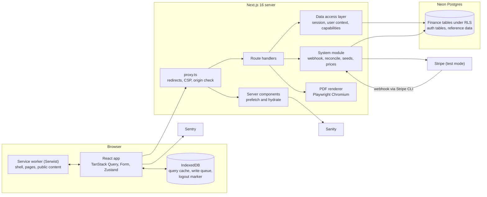

# Daybook: Root Spec

16 Oct 2026 · @Himanshu

This spec holds every rule that crosses features: terms, routes, global flows, conventions, architecture, API, security, capabilities, quality and acceptance. Feature specs (`features/`) and platform specs (`platform/`) build on it and may narrow a rule here, never contradict it. Reasons and rejected options live in [02-decisions.md](02-decisions.md); expected numbers live in [03-golden-dataset.md](03-golden-dataset.md).

## 1. How to use this spec

- **Readers:** you and Claude Code. Rules carry IDs (for example `MON-3`) so feature specs, code comments and tests can cite them.
- **Words:** "must" is required, "never" is forbidden, "should" is the default a feature spec may change only with a stated reason.
- **Precedence:** a feature spec may narrow a root rule. A contradiction between the two is a bug in one of them and is raised before coding.
- **No open questions live in specs.** Every rule here is stated as it applies. Decision status and history are in the decisions log.
- **Stretch** means in scope but built after the core, in milestone M8. **Out** means not built.
- **Changes:** a change in behavior updates its spec in the same commit, and a new decision gets a new D-ID (D-65).
- **Illustrations** (payload shapes, sketches) are examples, not schemas. Database schemas are designed separately (D-09); this spec only constrains them.

## 2. Product

Daybook is a multi-user personal finance and investment dashboard on a real backend. Users record Transactions and manage Budgets, Subscriptions and Goals. A seeded mock portfolio and a dashboard of metrics and charts sit beside them. Everything except investments, prices and insights is real, isolated user data.

There is one kind of user. Daybook Premium is a billing entitlement, not a role (D-28, D-167).

| Feature                                                                                 | Free | Premium   |
| --------------------------------------------------------------------------------------- | ---- | --------- |
| Dashboard, Transactions, Budgets, Subscriptions, Investments, Insights, search, offline | Yes  | Yes       |
| Active Goals                                                                            | 3    | Unlimited |
| Line, bar and donut charts                                                              | Yes  | Yes       |
| Calendar heat map; comparative charts (budget vs actual, period over period)            | No   | Yes       |
| Weekday-by-hour heat map (Stretch)                                                      | No   | Yes       |
| Monthly report, PDF and CSV                                                             | Yes  | Yes       |
| Quarterly and annual reports                                                            | No   | Yes       |
| Learn: public posts (also logged out)                                                   | Yes  | Yes       |
| Learn: members posts (Stretch)                                                          | Yes  | Yes       |
| Learn: Premium guides (Stretch)                                                         | No   | Yes       |

- **Prices (D-125):** monthly 399 INR or 4.99 USD; yearly 3,990 INR or 49.90 USD (10 months' price). Profile country IN pays in INR; every other country pays in USD.
- **Lapse (D-29):** nothing is deleted. If more than 3 Goals are active, the 3 oldest stay editable and the rest lock read-only until the user picks which 3 stay editable. Premium views show a locked card (D-119). Every rule is enforced on the server.

## 3. Terms

These names are fixed. "Subscription" always means a recurring bill the user tracks; anything billed by Stripe is "Premium" or "Daybook Premium" (D-70).

| Term                     | Meaning                                                                                                                            |
| ------------------------ | ---------------------------------------------------------------------------------------------------------------------------------- |
| Transaction              | One record of money with a type, a positive amount, an occurrence time and date, and a category or a Goal                          |
| Transaction type         | `income`, `expense`, `refund`, `goal_contribution`, `goal_withdrawal` (TXN-1)                                                      |
| Payee                    | The counterparty of income, expenses and refunds, for example "Swiggy" or "Acme Corp"                                              |
| Description              | Optional short text shown under the payee in lists                                                                                 |
| Note                     | Optional longer text shown in the detail view                                                                                      |
| Category                 | One fixed key per income, expense or refund (CAT)                                                                                  |
| Subscription             | A recurring bill the user tracks: streaming, rent, insurance, loan EMI, gym. It generates its past charges as expense Transactions |
| Charge                   | An expense Transaction generated by a Subscription for one due date                                                                |
| Tombstone                | The record that a charge was deleted, so catch-up never recreates it                                                               |
| Budget                   | A monthly spending limit for one expense category, effective from a month onward                                                   |
| Utilization              | Category spending divided by its Budget limit for a month                                                                          |
| Goal                     | A savings target; states `active`, `completed`, `archived`, and `locked` after a Premium lapse                                     |
| Contribution, withdrawal | Transactions moving money into or out of a Goal                                                                                    |
| Spending (Out)           | Expenses minus refunds in a period                                                                                                 |
| Net savings              | Income minus spending in a period                                                                                                  |
| To Goals                 | Contributions minus withdrawals in a period                                                                                        |
| Unallocated              | Net savings minus To Goals                                                                                                         |
| Premium, Daybook Premium | The app's paid tier, billed through Stripe                                                                                         |
| Capability               | A named thing a user may or may not do, resolved on the server (section 10)                                                        |
| Entitlement              | A capability granted by the user's Premium plan, from Stripe                                                                       |
| Feature flag             | A capability switched on or off by the developer                                                                                   |
| Profile                  | Country, currency, timezone and week start of a user                                                                               |
| Today                    | The current date in the profile timezone                                                                                           |
| Recording date           | The date, in the profile timezone, on which a Transaction was first created                                                        |
| Confirmed                | Accepted and stored by the server                                                                                                  |
| Pending                  | Created or changed on the device, not yet accepted by the server                                                                   |
| Rejected                 | Refused by the server with a 4xx; waits for the user in the sync panel                                                             |
| Write queue              | The IndexedDB store of pending changes, replayed in order                                                                          |
| Private data             | Per-user rows: Transactions, Budgets, Subscriptions, Goals, investment trades, profile, layout, entitlements, dismissed insights   |
| Reference data           | Shared rows: currencies, categories, mock assets, mock prices                                                                      |
| Public content           | Learn posts from Sanity                                                                                                            |
| Data access layer (DAL)  | The single server module every private read and write passes through                                                               |

## 4. Routes and navigation

| Route                      | Purpose                                                                                                                              | Access                                  | Offline                                    |
| -------------------------- | ------------------------------------------------------------------------------------------------------------------------------------ | --------------------------------------- | ------------------------------------------ |
| `/`                        | Logged in: redirect to `/dashboard`. Logged out: a small landing page with Log in, Sign up and the latest public Learn posts (D-182) | Public                                  | Yes                                        |
| `/signup`, `/login`        | Email and password                                                                                                                   | Logged out                              | Shows offline state                        |
| `/onboarding`              | Country, currency, timezone, week start                                                                                              | Logged in, no profile                   | Shows offline state                        |
| `/dashboard?month=YYYY-MM` | Widgets for one month, insights panel                                                                                                | Logged in                               | Cached                                     |
| `/transactions?...`        | Infinite list, filters, totals; entry and edit open in a dialog                                                                      | Logged in                               | Cached first pages; writes queued          |
| `/budgets?month=YYYY-MM`   | Limits and utilization per category                                                                                                  | Logged in                               | Cached; writes queued                      |
| `/subscriptions`           | List, monthly and annual cost, upcoming renewals                                                                                     | Logged in                               | Cached; writes queued                      |
| `/goals`, `/goals/[id]`    | Progress, contributions, withdrawals                                                                                                 | Logged in                               | Cached; writes queued                      |
| `/investments`             | Holdings, allocation, value over time                                                                                                | Logged in                               | Cached                                     |
| `/analytics?...`           | Every chart with date range and category filters                                                                                     | Logged in; some charts Premium          | Last viewed range cached                   |
| `/insights?month=YYYY-MM`  | All insights for a month                                                                                                             | Logged in                               | Cached                                     |
| `/reports`                 | Choose type and period; download PDF or CSV                                                                                          | Logged in; quarterly and annual Premium | Offline state                              |
| `/learn`, `/learn/[slug]`  | Articles, news, guides                                                                                                               | Public; gated tiers Stretch             | Read posts cached                          |
| `/settings/profile`        | Display name, country (fixed), currency (until finance data exists), timezone, week start                                            | Logged in                               | Offline state                              |
| `/settings/appearance`     | Theme (per device)                                                                                                                   | Logged in                               | Yes                                        |
| `/settings/dashboard`      | Show, hide and reorder widgets                                                                                                       | Logged in                               | Writes queued                              |
| `/settings/security`       | Change password, active sessions                                                                                                     | Logged in                               | Offline state                              |
| `/settings/data`           | Load or remove demo data, reset data, export (Stretch), delete account                                                               | Logged in                               | Offline state                              |
| `/settings/billing`        | Plan, upgrade with Stripe Elements, manage in Customer Portal                                                                        | Logged in                               | Cached page; actions online only (P1, F12) |
| `/offline`                 | Service-worker fallback page                                                                                                         | Public                                  | Yes                                        |
| `/print/reports/...`       | Headless render target for PDFs, token-protected                                                                                     | Internal                                | No                                         |

**Navigation (layout by Claude Design; items and order are spec)**

- Desktop sidebar: Dashboard, Transactions, Budgets, Subscriptions, Goals, Investments, Analytics, Insights, Reports, Learn, then Settings.
- Phone bottom bar: Dashboard, Transactions, Add, Budgets, More. More holds the rest.
- Header on every logged-in page:
    - A search button (opens the command palette; also Ctrl or Cmd+K).
    - An Add button that opens the entry dialog.
    - Sync status with the pending-plus-rejected count.
    - A Premium badge or an Upgrade link.
    - The user menu.
- Global banners: offline (with "as of" time), update available, payment failed (past due), session expired, Premium lapse with Goals to choose.

## 5. Global flows

### 5.1 Sign-up and onboarding

1. `/signup`: email, password (12 to 128 characters, breached-password check, strength meter), display name (SEC-10).
2. The account and session are created; the user lands on `/onboarding`. Any logged-in route redirects there until a profile exists.
3. Onboarding asks for four things:
    - **Country:** pre-filled from the country of the device's time zone, else from the browser locale's region (D-208).
    - **Currency:** pre-filled from the country if it is in the supported list (MON-2), otherwise USD (D-210).
    - **Timezone:** pre-filled from the device if it belongs to the country, otherwise the country's default zone (F02, BR-F02-05); onboarding offers only that country's zones, Settings offers every zone (D-211).
    - **Week start:** pre-filled from the country's CLDR week data (F02).
4. Submitting creates the profile and seeds the user's mock portfolio (D-104), then opens `/dashboard`.
5. While the account has no Transactions, Budgets, Subscriptions or Goals, the dashboard shows one onboarding panel (D-114, D-282) with Add your first Transaction and Load demo data (F15).

### 5.2 Boot sequence

Runs on every app start and when the app returns online.

1. **Logout marker.** If the logout-pending marker exists, show the login screen and stop. When online, call sign-out first, then remove the marker once sign-out is confirmed (5.3; P1).
2. **Restore.** Load the persisted query cache if its buster equals the current build id and its owner equals the last user; render last-known data with an "as of" time.
3. **Identity.** `GET /api/me`:
    - 401: open login and pause the queue (5.4).
    - A different user than the cache owner: wipe every cache and the queue.
4. **Replay** the write queue (OFF-5), after recomputing the queue cookie from it (P1).
5. **Catch-up.** `POST /api/sync/catch-up` creates due Subscription charges up to today (JOB-2). Missing prices come from the daily pass, which the route wrapper runs (JOB-3). Replay runs first so catch-up sees the user's latest Subscription edits (D-181). While items still wait, the endpoint skips (F05, BR-F05-06), and the app calls it again after the next successful replay.
6. **Refresh.** Invalidate affected queries if replay applied items or catch-up created rows.
7. **Housekeeping.** Register Background Sync if the queue is not empty (Chromium only), and check for a service-worker update (5.7).

The data access layer also runs catch-up lazily, once per user per day, before any finance read (JOB-1). The numbers are therefore right even if step 5 failed.

### 5.3 Logout

**Online**

1. If the queue has items, try to replay them, waiting up to 10 seconds.
2. If items remain, show a modal: "N changes have not been saved. Logging out deletes them." with Cancel and Delete and log out.
3. Call sign-out; the server revokes the session and clears the cookie.
4. Wipe the persisted query cache, the write queue, the service-worker page cache, Zustand stores and the layout cache. Theme is kept. If sign-out did not succeed, write the marker as in the offline steps, its cookie before this wipe (P1).
5. Go to `/login`.

**Offline**

1. If the queue has items, show the same modal without the replay attempt.
2. Wipe as in step 4 above.
3. Write the logout-pending marker to IndexedDB, where both the page and the service worker can read it, and to a cookie the proxy reads (D-140, D-367).
4. Show the login screen with "You are offline. Connect to log in."
5. On the next online page request, the proxy sees the cookie and revokes the session before anything renders. The app's own sign-out at the next start also revokes it, then the marker is removed.

The marker exists because the session cookie is `httpOnly` and cannot be removed by JavaScript. Without it, the next online visit would silently log the user back in.

### 5.4 Session expiry

A 401 from any request does five things:

- pauses the queue, keeping its items;
- keeps cached data readable;
- shows the session-expired banner (F01);
- after login as the same user, resumes the queue;
- after login as a different user, wipes caches and queue first.

### 5.5 Premium purchase, management and lapse

**Purchase (D-127, D-128)**

1. From `/settings/billing` or any locked spot, the user chooses Monthly or Yearly.
2. `POST /api/billing/checkout-session` makes the server:
    - ensure a Stripe Customer exists;
    - refuse when the Customer already has a live subscription, and expire its other open sessions (D-299);
    - pick the currency from the profile country (IN gives INR, otherwise USD);
    - create a Checkout Session with `ui_mode: 'elements'`;
    - return its client secret.
3. The client renders the Payment Element, styled through Stripe's Appearance API, and the user pays with a test card. Payment methods that redirect come back through `return_url`.
4. `POST /api/billing/reconcile` makes the server retrieve the session and, through the system module, sync the customer's subscriptions and active entitlements from Stripe (F12, BR-F12-11).
5. The client shows "Activating Premium" and calls reconcile again 2 seconds after each answer until it reports Premium, then refetches `/api/me` (P4, D-301). If 30 seconds pass first, it stops and the page says "Payment received. Premium is still activating; refresh this page in a minute."
6. Webhooks for subscription and entitlement changes, forwarded by the Stripe CLI, run the same sync idempotently.

**Without webhooks:** after `/api/me` answers, a lazy billing check syncs from Stripe when a known plan date has passed, the last sync is a day old, or a paid plan has no entitlements yet (F12, D-310).

**Management:** `POST /api/billing/portal` returns a Customer Portal URL, and the client goes there. There the user cancels at period end, switches between monthly and yearly, updates the card or sees invoices.

**Failed payment (D-130):** Stripe retries and the subscription is past due, so the payment-failed banner shows and Premium stays. Stripe is configured to cancel after the final retry. The next sync, from the webhook, reconcile or the lazy billing check, then removes the entitlements.

**Lapse:** Premium capabilities disappear from `/api/me`.

- Goals beyond 3 active lock (D-29), with a banner to choose which 3 stay editable.
- Premium charts show locked cards.
- Quarterly and annual reports show an upgrade prompt.
- Gated Learn posts show a teaser.

### 5.6 Offline writes

A write made offline is applied to the screen as pending and stored in the write queue. It is replayed in order when the network returns. Confirmed numbers never include pending changes. Full rules: OFF-5 to OFF-8 and platform spec P1.

### 5.7 App update

1. The service worker finds a new version and the app shows "Update available" with Reload.
2. On Reload: wait for any in-flight replay to finish, activate the new worker, then reload. Other open tabs offer their own Reload instead of reloading (P1).
3. On the next start: migrate queued items to the new schema version before replay, and discard the persisted query cache, whose buster no longer matches.

## 6. Conventions

### 6.1 Naming

- **NAM-1** "Subscription(s)" in docs, code and interface means a user-tracked recurring bill. Stripe objects appear only inside the billing module; everything the user sees about billing says Premium or Daybook Premium. F12 alone writes Stripe's object as "subscription" in lower case, and names its fields `stripeSubscriptionId` and so on.
- **NAM-2** Category keys, capability codes and Transaction types are stable identifiers. Changing a label never changes a key.

### 6.2 Money

- **MON-1** Every amount is an integer number of the currency's minor unit, in storage, in JSON and in arithmetic. Never a float.
- **MON-2** Supported currencies and their ISO 4217 exponents (D-73):

    | Code | Exponent | Stored for 1,240.50 | Default for                                   |
    | ---- | -------- | ------------------- | --------------------------------------------- |
    | INR  | 2        | 124050              | IN                                            |
    | USD  | 2        | 124050              | US, and any country without a listed currency |
    | EUR  | 2        | 124050              | Euro-area countries                           |
    | GBP  | 2        | 124050              | GB                                            |
    | JPY  | 0        | 1240 (no fraction)  | JP                                            |
    | KWD  | 3        | 1240500             | KW                                            |

    A unit test asserts that each exponent equals the fraction digits `Intl.NumberFormat` uses for that currency. Stripe's own currency rules apply only to Premium prices, never to finance amounts.

- **MON-3** One currency per user, from the profile. It is fixed once any Transaction, Budget, Subscription or Goal exists (D-212); Reset my data unlocks it.
- **MON-4** Display uses `Intl.NumberFormat(numberLocale, { style: 'currency', currency })`. Two locales come from the profile country (D-214, F02):
    - `numberLocale` is the country's own format through `Intl`, with Latin digits, precomputed per country (for example `hi-IN-u-nu-latn`, so INR shows `1,00,000.00`, and `de-DE-u-nu-latn`, so EUR shows `1.240,50 €`);
    - `dateLocale` is `en-<country>`, for dates and times in English.

    Before a profile exists, the browser locale is used for both.

- **MON-5** An amount is at least one minor unit and at most 999,999,999 major units plus a full fraction (for INR: 99,999,999,999 minor units). Every limit is below `Number.MAX_SAFE_INTEGER`, so JSON numbers are safe.
- **MON-6** SQL sums arrive from `pg` as strings (bigint and numeric). The data layer converts them with a parser that throws above `Number.MAX_SAFE_INTEGER`; plain `Number()` on them is never used.
- **MON-7** Any division (monthly equivalents, averages, price times quantity) rounds half away from zero to the minor unit, once, at the end of the calculation. The one exception: an amount the user must save, such as a Goal's required monthly amount, rounds up.
- **MON-8** Percentages are computed from integers and shown with one decimal. A zero denominator shows "—".
- **MON-9** Investment quantities are exact decimals with up to 8 places, sent as strings. A holding's value, a trade's flow and a cost are computed from the quantity and the base price in one step and rounded once (MON-7; F07). A unit price, or an average cost per unit, is rounded to the minor unit for display only.

### 6.3 Dates and times

- **TIME-1** Instants are UTC, stored as `timestamptz` and sent as ISO 8601 with `Z`: `occurred_at`, `created_at`, `updated_at`.
- **TIME-2** `occurred_on` is the calendar date of `occurred_at` in the profile timezone at the moment of writing. The client sets it; the server checks it. A later timezone change never moves it; editing the time recomputes it with the current profile timezone.
- **TIME-3** All bucketing uses `occurred_on`: months, days, Budgets, reports, heat maps, insights. Ordering uses `occurred_on`, then `occurred_at`, then `id`, so day groups never interleave after a timezone change (D-218).
- **TIME-4** Instants are displayed in the profile timezone. When the device's current UTC offset differs from the profile zone's, the header shows a dismissible notice: "Times are shown in Kolkata time (GMT+05:30). Your device is on GMT+04:00." (F02, D-215).
- **TIME-5** Today is the current date in the profile timezone. The server derives it from its UTC clock and the profile timezone, never from the device.
- **TIME-6** Subscription charges get `occurred_on` = due date and `occurred_at` = 00:00 of that date in the profile timezone. The interface shows "Auto" instead of a time.
- **TIME-7** A user-entered `occurred_on` must fall between the recording date minus 10 days and the recording date, inclusive. Edits use the same window, anchored to the original recording date. System rows (charges, demo, seed) are exempt. The server also rejects a `created_at` later than the request clock (`ctx.now`, P2) plus 5 minutes. Refusal: 422 `date_out_of_window` (D-77).
- **TIME-8** Months, quarters (January to March, and so on) and years (January to December) are calendar periods. The week starts on the profile's week start: Monday, Sunday or Saturday, defaulting from the region (D-76).
- **TIME-9** Subscription schedules anchor to the start date's day of month and clamp to each month's length: 31 January, 28 or 29 February, 31 March. Weekly adds 7 days. Quarterly adds 3 anchored months. Yearly adds 12 anchored months, so 29 February becomes 28 February in other years.
- **TIME-10** Date math uses date-fns 4 with `@date-fns/tz`. Business dates never use `Date` local getters.

### 6.4 IDs

- **ID-1** Primary keys are UUIDv7. The client generates ids for its own creates, so offline items can reference each other (a new Goal and its first contribution). The server generates ids for system rows.
- **ID-2** Every mutation also carries its own Idempotency-Key, a UUIDv7 separate from the entity id (API-3).

### 6.5 Transaction types and arithmetic

- **TXN-1** Types: `income`, `expense`, `refund`, `goal_contribution`, `goal_withdrawal` (D-81).
- **TXN-2** The amount is always positive; the direction comes from the type.
- **TXN-3** `income` takes an income category. `expense` and `refund` take an expense category. Goal types take a Goal and no category.
- **TXN-4** The payee is required for income, expense and refund, and absent for Goal types. A charge's payee starts as its Subscription's name and can be edited (F03).
- **TXN-5** For a period P, over confirmed Transactions with `occurred_on` in P:

    ```text
    Income             = Σ income
    Spending (Out)     = Σ expense − Σ refund
    To Goals           = Σ goal_contribution − Σ goal_withdrawal
    Net savings        = Income − Spending
    Unallocated        = Net savings − To Goals
    Savings rate       = Net savings ÷ Income            ("—" when Income = 0)
    Category spending  = Σ expense(c) − Σ refund(c)
    Utilization        = Category spending(c) ÷ Budget limit(c, month)
    Goal progress      = Σ contributions(g) − Σ withdrawals(g), all time
    ```

- **TXN-6** Pending changes never enter these formulas. They are summed separately and shown as annotations, for example "45.00 pending".
- **TXN-7** Results may be negative (net savings, unallocated, a category after a refund for an earlier month). Tables, bar charts and line charts show negatives below zero. Donut charts and heat maps clamp a negative value to zero and add a footnote: "Refunds exceeded spending" (D-185).
- **TXN-8** Every Transaction has a source, `manual` or `subscription`, and a separate `demo` flag that marks rows loaded as demo data (D-219). The list's source filter offers both sources. Scenario-account rows are the account's own data: source as generated, `demo` false (F15).

### 6.6 Categories

- **CAT-1** Categories are fixed lists with stable snake_case keys. Labels, icons and colors live in code and are mirrored into a reference table by migration.
- **CAT-2** Expense categories (D-178): `food`, `shopping`, `transportation`, `utilities`, `entertainment`, `housing`, `health`, `education`, `travel`, `insurance`, `personal_care`, `gifts_donations`, `fees_taxes`, `loans`, `other`.
- **CAT-3** Income categories: `salary`, `freelance`, `investments`, `gifts`, `other_income`.
- **CAT-4** Each category has one fixed color used by every chart (D-116).

### 6.7 Input limits

Text is trimmed and normalized to Unicode NFC, and control characters are rejected; a note keeps line feeds (D-176). A lone surrogate is rejected everywhere, and so are U+2028 and U+2029 in a single-line field. Text of only whitespace and invisible characters, such as the zero-width space, counts as empty (D-498). Lengths count Unicode code points (D-230).

| Field               | Rule                                                     |
| ------------------- | -------------------------------------------------------- |
| Payee               | Required for income, expense, refund; 1 to 80 characters |
| Description         | Optional; up to 120                                      |
| Note                | Optional; up to 500                                      |
| Subscription name   | Required; 1 to 60                                        |
| Goal name           | Required; 1 to 60                                        |
| Display name        | Required; 1 to 50                                        |
| Amount, Goal target | MON-5                                                    |
| Search text         | 3 to 100 characters, or a numeric amount of any length   |

### 6.8 Periods

- **PER-1** Period forms: month `2026-10`, quarter `2026-Q4`, year `2026`, range `from` and `to` as inclusive dates.
- **PER-2** Each screen uses one control:
    - Dashboard: the month picker.
    - Transactions and Analytics: ranges with presets (this month, last month, last 3 months, year to date, last 12 months, custom); F03 defines each one (D-227). Transactions adds All time, its default. Analytics always carries both dates and defaults to the last 12 months (D-285).
    - Investments: trailing ranges (1m, 3m, 6m, YTD, 1y, all; default 1y) or a custom `from` and `to` (F07, D-278).
    - Reports: month, quarter or year.
- **PER-3** A period that contains today is partial; reports label it "to date".
- **PER-4** The previous period has the same length and ends the day before: the previous month for a month, the previous N days for an N-day range. Analytics' period comparison cuts both periods at the same elapsed day when the current one runs past today (F09, D-296).

### 6.9 The filter object

One filter object drives the list, its totals, Analytics and drill-downs. One server function turns it into SQL, so they cannot disagree (D-88).

| Field        | URL parameter | Values                                                                          | Used by                      |
| ------------ | ------------- | ------------------------------------------------------------------------------- | ---------------------------- |
| Date range   | `from`, `to`  | `YYYY-MM-DD`                                                                    | Transactions, Analytics      |
| Month        | `month`       | `YYYY-MM`                                                                       | Dashboard, Budgets, Insights |
| Types        | `type`        | Comma list of TXN-1 types                                                       | Transactions                 |
| Categories   | `cat`         | Comma list of keys                                                              | Transactions, Analytics      |
| Text         | `q`           | FIL-3                                                                           | Transactions                 |
| Amount range | `min`, `max`  | Major units, for example `1500.00`                                              | Transactions                 |
| Source       | `src`         | `manual`, `subscription`                                                        | Transactions                 |
| Goal         | `goal`        | Goal id                                                                         | Transactions                 |
| Subscription | `sub`         | Subscription id: that Subscription's charges (D-255)                            | Transactions                 |
| Sort         | `sort`, `dir` | `date` or `amount`; `desc` or `asc`                                             | Transactions                 |
| Group        | `group`       | `day`, `category`, `payee` or `none`; sets the list's grouping, selects no rows | Transactions                 |

- **FIL-1** Fields combine with AND; values inside one list combine with OR.
- **FIL-2** The list, its header totals, Analytics and chart drill-downs all use the same filter-to-SQL function.
- **FIL-3** Text matches payee, description and note, case-insensitively as Postgres's `lower()` folds case (D-497), as a substring, over the user's own rows. No text index serves it: under row-level security, Postgres uses an index only for leakproof conditions, and `ILIKE` is not one (D-48). A numeric query also matches the exact amount, converted to minor units.
- **FIL-4** Committed filters live in the URL. A text box keeps its own draft and commits after 300 ms without typing.
- **FIL-5** An invalid parameter is dropped with a notice, never an error page.
- **FIL-6** A category filter excludes Goal rows, which have no category.

## 7. Architecture

### 7.1 The parts



The browser never touches the database. Every private read and write passes the data access layer. The service worker caches only the shell, pages and public content; private data is cached once, by TanStack Query.

### 7.2 Server boundary

- **SRV-1** The data access layer resolves the session through Better Auth, which uses the auth pool. It then opens a transaction on the runtime pool and sets `app.user_id` with a transaction-local `set_config` before any query.
- **SRV-2** Authorization happens where data is read or written. `proxy.ts` never authorizes data.
- **SRV-3** Every mutation is a route handler. Server Actions are not used, so CSRF checks, idempotency and offline replay have one path (D-173).
- **SRV-4** `proxy.ts` has four jobs (D-172):
    1. Optimistic redirects: no session cookie on a logged-in route goes to `/login`; a session on `/login` or `/signup` goes to `/dashboard`.
    2. A nonce-based CSP and the security headers (SEC-8).
    3. An early reject of cross-origin or non-JSON mutations, repeated in the route-handler wrapper.
    4. A request id, carried into logs and Sentry.
- **SRV-5** Code that uses the system role lives in one named module: the Stripe sync, Customer storage and deletion (webhook, billing handlers, lazy billing check, account deletion), seeding, global price catch-up and the flag script.
- **SRV-6** API responses carry a `Server-Timing` header with database time.
- **SRV-7** Row locks in one transaction are taken in this order, so no two paths can deadlock (D-243):
    1. The user's profile row: `FOR KEY SHARE` for finance-row writes; `FOR UPDATE` for a currency change, demo load or removal, and Reset my data; the update of `last_catch_up_on` by the lazy check and the boot endpoint; the update of `goalsChosenAt` by F06's editable choice. A transaction never upgrades its profile lock.
    2. The P4 advisory limit lock.
    3. Goals, in id order.
    4. Subscriptions, in id order.
    5. Any other rows.

### 7.3 Data per screen

| Screen            | Rendering                           | Data                                                  | Persisted for offline                                                           | Writes offline                               |
| ----------------- | ----------------------------------- | ----------------------------------------------------- | ------------------------------------------------------------------------------- | -------------------------------------------- |
| Dashboard         | Server prefetch, client widgets     | Dashboard and insights queries for the month          | Current and last viewed month                                                   | n/a                                          |
| Transactions      | Server prefetch, client list        | Infinite list and summary for the filter; saved views | First 2 pages and summary of the default filter; payee suggestions; saved views | Yes; saved views online only                 |
| Budgets           | Client                              | Budgets for the month                                 | Current month                                                                   | Yes                                          |
| Subscriptions     | Client                              | Subscriptions, upcoming renewals                      | Yes                                                                             | Yes                                          |
| Goals             | Client                              | Goals list, viewed Goal details                       | Yes                                                                             | Yes, including contributions and withdrawals |
| Investments       | Client                              | Portfolio summary, series and holdings                | Last viewed range, and the holdings                                             | Read-only                                    |
| Analytics         | Client                              | Chart rollups for the filter                          | Last viewed range                                                               | n/a                                          |
| Insights          | Client                              | Insights for the month                                | Current and last viewed month                                                   | Dismiss is online only                       |
| Reports           | Client form, file download          | Report endpoint                                       | No                                                                              | Online only                                  |
| Search            | Palette                             | Search endpoint                                       | No                                                                              | Online only                                  |
| Learn             | Server components                   | Sanity                                                | Read posts, by the service worker                                               | n/a                                          |
| Settings, billing | Server components with client forms | Profile, auth, billing endpoints                      | Profile through `/api/me`                                                       | Online only, except dashboard layout         |

### 7.4 State ownership

| State                                                  | Owner                                                       |
| ------------------------------------------------------ | ----------------------------------------------------------- |
| Server data                                            | TanStack Query; allow-listed queries persisted to IndexedDB |
| Profile, plan, capabilities                            | The `/api/me` query, persisted                              |
| Form state                                             | TanStack Form with Zod schemas shared with the server       |
| Committed filters and period                           | URL search params                                           |
| Unsubmitted text (search drafts)                       | Component state                                             |
| UI chrome: sidebar, palette, dialogs, layout edit mode | Zustand `ui` store                                          |
| Sync status: counts, running, last error               | Zustand `sync` store, fed by the queue                      |
| Theme                                                  | next-themes, local storage, per device                      |
| Dashboard layout                                       | Server, per account, with a local-storage cache             |

- **STATE-1** Zustand stores are created per request inside a provider and used only in client components. Server components never read them.
- **STATE-2** Zustand never holds server data.
- **STATE-3** The persisted query cache follows three rules (D-179):
    - An allow-list of queries; maxAge 7 days; gcTime at least maxAge; the buster is the build id.
    - The owner's user id is stored with it.
    - A different owner wipes it.

### 7.5 Caching and offline

| Request                               | Strategy                                                                                                                  | Owner          |
| ------------------------------------- | ------------------------------------------------------------------------------------------------------------------------- | -------------- |
| Hashed static assets, fonts, icons    | Precache or cache-first                                                                                                   | Service worker |
| Documents                             | Network-first with a timeout, falling back to the cached page or `/offline`; visited pages are warmed into the cache (P1) | Service worker |
| RSC payloads and router prefetches    | Never cached                                                                                                              | None           |
| Private API GET                       | Network-first through TanStack Query; the persisted copy is used when the network fails                                   | TanStack Query |
| Learn pages and Sanity images         | Learn pages as documents (network-first); Sanity and optimized images cache-first with a size cap (P1)                    | Service worker |
| Auth, billing, Stripe, every mutation | Never cached                                                                                                              | None           |

- **OFF-1** The service worker never caches private API responses. Serwist's default `/api` rule is removed.
- **OFF-2** Cached documents count as private. They are wiped on logout and on a user switch. RSC payloads are never cached (P1).
- **OFF-3** Development builds do not cache; offline behavior is tested on a production build.
- **OFF-4** Offline-writable: Transactions of every type, Budgets, Subscriptions, Goals and the dashboard layout. Everything else is online only and shows an offline state, never a silent failure.
- **OFF-5** Write queue rules (detail in P1):
    - **Item fields:** id, idempotency key, user id, schema version, method, path, body, the row it was made against as the screen showed it (confirmed data with settling and earlier queued changes applied), entity type and id, base version, dependencies, status (`pending`, `inflight`, `conflict`, `rejected`, `blocked`), hold time, first-sent time, attempts, next attempt time, server failures, last error, created time; the queue itself can be paused; Subscription items also keep the deletion count their dialog showed (F05, BR-F05-15).
    - **Order:** replay in creation order.
    - **Coalescing (D-138, D-265, D-322, D-362):** only a create never yet sent can merge. For Transactions, such a create followed by an edit becomes one create. For every entity, such a create followed by a delete removes both. Budget, Subscription and Goal items are otherwise never merged, since their changes carry their own dates and schedules.
    - **Version chaining (D-269):** once an item for an entity is confirmed, later queued items for that entity take the version it returned, and a queued create counts as version 1. A device's own earlier change to the same entity is therefore never a conflict. A charge's version can still move because of a Subscription change (F05), which shows as an ordinary conflict.
    - **Dependent items (D-266, D-323):** an item that references a queued create (a contribution to a Goal created offline), or follows another item for the same entity, waits while that item is rejected or in conflict. Retry replays the create, then it. Discard discards both, saying how many. Removing a queued create removes the queued items that reference it.
    - **One runner:** across tabs, through the Web Locks API (D-145).
    - **Triggers:** a new item, app start, the `online` event, the tab becoming visible, a backoff or hold timer, and on Chromium a Background Sync registration that runs the same runner.
    - **Network errors, 408, 429, 5xx:** retry with exponential backoff and jitter, capped at 5 minutes.
    - **401:** pauses the queue. **409 `build_mismatch`:** pauses the queue until the update (P1). **409 `version_conflict`:** marks a conflict for the user. **404 on a DELETE:** counts as done, since the row is already gone (D-239). **Any other 4xx, including other 409s:** marks the item rejected.
    - **Durability:** the app requests persistent storage; items are migrated by schema version after an update.
- **OFF-6** Pending display:
    - Pending rows carry a "Pending sync" badge.
    - Pending amounts appear as a separate annotation beside the confirmed number, and never trigger Budget alerts.
    - After a sync, the annotation stays until the affected queries have refetched.
- **OFF-7** A rejected or conflicting item appears in the sync panel and on its row ("Not saved"). A rejected item offers Retry, Edit (for creates and edits) and Discard. A conflict offers Review, which shows both versions with Keep mine (resend against the current version) and Keep theirs (discard), and Discard (D-137, D-139; P1).
- **OFF-8** The layout is not a write-queue item. A local copy with a `synced` flag holds it until the server accepts it. The server keeps the later `changedAt`, without a version check, so an old layout from a device that was offline never overwrites a newer one (F08, D-183, D-279).

### 7.6 Catch-up jobs

- **JOB-1** There is no cron. Catch-up runs on boot (`POST /api/sync/catch-up`), lazily once per user per day in the data access layer, and inside every Subscription create, change and delete (F05).
    - **While a queue is waiting:** the lazy run is skipped for any request that carries `Daybook-Queue: pending` (D-244). The client sends that header while its write queue holds pending or in-flight Subscription items. From M5 it also sets the `daybook_queue` cookie meanwhile, so page requests carry the signal too (P1, D-325). Queued Subscription changes therefore replay before catch-up (D-181).
    - **The boot endpoint:** runs catch-up itself and declares `catchUp: false`.
- **JOB-2** Subscription catch-up runs in the user's context. It creates one charge per due date up to today that has neither a charge nor a tombstone. It is idempotent through uniqueness on Subscription and due date.
    - **Locks** follow SRV-7. Every run holds a lock on the user's profile row: the lazy check's own update, the boot endpoint's update of `last_catch_up_on` (F05, BR-F05-06), or `FOR KEY SHARE` for a run inside a Subscription create, change or delete. Before computing missing due dates, a run locks each Subscription it covers with `FOR UPDATE`, in id order.
    - **After a create or edit:** the run covers only that Subscription, which its handler locked before writing it.
    - **Deleting a charge** takes the same Subscription lock (F03, D-236), so a deleted charge is never recreated.
    - **Today:** comes from the request clock as a parameter, never from SQL `now()` (P2, D-242).
- **JOB-3** Price catch-up runs through the system role, inside the global daily pass. The route wrapper starts the pass on each server process's first request of a UTC day (P2, BR-P2-27, D-292). It writes each catalog asset's daily price up to today's UTC date, under a marker row that commits with the prices, and is idempotent.

## 8. API conventions

- **API-1** Paths live under `/api` and are resource-oriented. There is no version prefix; queued items carry a schema version instead.
- **API-2** Mutations require `Content-Type: application/json` (415 otherwise) and an `Origin` equal to the app's origin (403 `cross_origin` otherwise). A mutation with no payload, such as a DELETE, sends `{}`. Two kinds of route are exempt:
    - `/api/webhooks/*`, which is verified by signature instead;
    - `/api/auth/*`, where Better Auth checks its own trusted origins (P2).
- **API-3** Every POST, PUT, PATCH and DELETE on user data requires an `Idempotency-Key` header (400 if missing). Three online-only endpoints are exempt: Subscription catch-up, billing, and account reset (P2, BR-P2-16).
    - The server stores key, status and response per user for 90 days (D-180).
    - A repeat with the same key returns the stored response.
    - The same key with a different body returns 422 `idempotency_key_reused`.
- **API-4** Updatable rows carry an integer `version`. PATCH and DELETE require `If-Match: "<version>"`. A mismatch returns 409 `version_conflict` with the current row in the body.
- **API-5** A create uses the client-generated id. If that id already exists for this user, the server returns the existing row with 200.
- **API-6** JSON conventions:
    - Money is integers in minor units, and every response holding money includes `currency`.
    - Every request that creates money or changes an amount carries `currency`; a mismatch with the profile is 422 `currency_mismatch` (D-213, F02).
    - Instants are ISO UTC; dates are `YYYY-MM-DD`.
    - Decimals (quantities) and ids are strings.
- **API-7** Lists use cursors:
    - Request: `?limit=` (default 50, maximum 100) and `?cursor=`.
    - Response: `data` holds `{ "items": [...], "nextCursor": "...", "prevCursor": "..." }` (API-11).
    - Cursors are opaque, encode the sort key and id, and stay stable when rows are inserted. One exception: a list ordered by group totals, such as F03's category and payee grouping, ends its cursors when a write reorders the groups (D-446).
- **API-8** Every response carries `x-request-id` and `Server-Timing`.

**Errors (API-9).** Every error uses one envelope:

```json
{
	"error": {
		"code": "validation_failed",
		"message": "Payee is required.",
		"fields": { "payee": "Required" },
		"details": {},
		"requestId": "0192f0c4-..."
	}
}
```

| Status     | Code                     | When                                                                        | Write queue does        |
| ---------- | ------------------------ | --------------------------------------------------------------------------- | ----------------------- |
| 400        | `bad_request`            | Malformed JSON, missing header                                              | Reject                  |
| 401        | `unauthenticated`        | No session or an expired one                                                | Pause                   |
| 403        | `cross_origin`           | Origin mismatch                                                             | Reject                  |
| 403        | `profile_required`       | Called before onboarding                                                    | Reject                  |
| 403        | `premium_required`       | Needs Premium; `details` names the capability and any limit                 | Reject                  |
| 403        | `feature_off`            | A flag is off                                                               | Reject                  |
| 404        | `not_found`              | Missing, or not the user's                                                  | Reject                  |
| 409        | `version_conflict`       | `If-Match` mismatch                                                         | Conflict, user resolves |
| 409        | `build_mismatch`         | A queued request's `Daybook-Build` differs from the server's build (P1, P2) | Pause until the update  |
| 409        | `id_conflict`            | A client id already used by another user                                    | Reject                  |
| 409        | `has_dependents`         | Deleting a row that still has linked rows                                   | Reject                  |
| 413        | `payload_too_large`      | JSON body over 64 KB                                                        | Reject                  |
| 415        | `unsupported_media_type` | Not JSON                                                                    | Reject                  |
| 422        | `validation_failed`      | Field errors in `fields`                                                    | Reject                  |
| 422        | `date_out_of_window`     | TIME-7                                                                      | Reject                  |
| 422        | `parent_missing`         | Linked Goal or Subscription is gone                                         | Reject                  |
| 422        | `idempotency_key_reused` | API-3                                                                       | Reject                  |
| 422        | `currency_mismatch`      | A money request's `currency` differs from the profile's (API-6)             | Reject                  |
| 429        | `rate_limited`           | Auth endpoints                                                              | Retry                   |
| 503        | `timeout`                | A statement exceeded 15 seconds                                             | Retry                   |
| 500 to 599 | `internal`               | Server failure                                                              | Retry                   |
| none       | none                     | Network failure                                                             | Retry                   |

Default messages for every code are in P2, section 8. A feature spec may add its own codes, and lists each one in its server surface.

**Endpoint map (API-10).** Conceptual; each feature spec owns its endpoints' details.

| Endpoint                                                                             | Methods                                                         | Spec         |
| ------------------------------------------------------------------------------------ | --------------------------------------------------------------- | ------------ |
| `/api/auth/*`                                                                        | Better Auth, allow-listed endpoints only, including delete-user | F01, P2      |
| `/api/session/expired`                                                               | GET                                                             | P2           |
| `/api/me`                                                                            | GET                                                             | P4, F02      |
| `/api/profile`                                                                       | GET, POST (onboarding), PATCH                                   | F02          |
| `/api/layout`                                                                        | GET, PUT                                                        | F08          |
| `/api/transactions`, `/api/transactions/[id]`                                        | GET, POST, PATCH, DELETE                                        | F03          |
| `/api/transactions/summary`                                                          | GET                                                             | F03          |
| `/api/transactions/facets`, `/api/transactions/amount-histogram`                     | GET                                                             | F03          |
| `/api/payees`, `/api/payees/history`                                                 | GET (suggestions and search; one payee's recent rows)           | F03          |
| `/api/transactions/bulk-delete`                                                      | POST (Stretch)                                                  | F03          |
| `/api/transaction-views`, `/api/transaction-views/[id]`                              | GET, POST, PATCH, DELETE (saved views)                          | F03          |
| `/api/budgets`, `/api/budgets/[id]`                                                  | GET, POST, PATCH, DELETE                                        | F04          |
| `/api/subscriptions`, `/api/subscriptions/[id]`                                      | GET, POST, PATCH, DELETE                                        | F05          |
| `/api/goals`, `/api/goals/[id]`                                                      | GET, POST, PATCH, DELETE                                        | F06          |
| `/api/goals/editable`                                                                | PUT (choose editable Goals after a lapse)                       | F06          |
| `/api/investments/*`                                                                 | GET                                                             | F07          |
| `/api/dashboard`                                                                     | GET                                                             | F08          |
| `/api/analytics/*`                                                                   | GET                                                             | F09          |
| `/api/insights`, `/api/insights/[key]/dismiss`, `/api/insights/[key]/restore`        | GET, POST                                                       | F10          |
| `/api/reports/[type]/[period]` (JSON), `/api/reports/[type]/[period]/pdf` and `/csv` | GET                                                             | F11          |
| `/api/billing/checkout-session`, `/reconcile`, `/portal`                             | POST                                                            | F12          |
| `/api/webhooks/stripe`                                                               | POST (signature, not cookie)                                    | F12          |
| `/api/search`                                                                        | GET                                                             | F13          |
| `/api/sync/catch-up`                                                                 | POST                                                            | P1, F05, F07 |
| `/api/demo-data`                                                                     | GET, POST, DELETE                                               | F15          |
| `/api/account/reset`, `/api/account/export`                                          | POST, GET (export is Stretch)                                   | F01          |
| `/api/push/subscriptions`                                                            | POST, DELETE (Stretch)                                          | P1           |

**Success (API-11).** Every successful Daybook response with a body is `{ "data": <output> }`, so a body holds exactly one of `data` and API-9's `error` (D-431).

- **Feature specs:** an Output column describes what `data` holds. `200 { deleted }` means `{ "data": { "deleted": ... } }`.
- **No body:** a 204 and a redirect have none.
- **Replays:** the route wrapper wraps what a handler returns, and an idempotency record stores the whole body, so a replay is identical (P2).
- **Not covered:** Better Auth's endpoints under `/api/auth/*` keep Better Auth's shapes, and webhook acknowledgements keep the provider's.

## 9. Security

- **SEC-1** Four database roles (D-13):

    | Role                                    | Used by                                                              | Can touch                                                                                  |
    | --------------------------------------- | -------------------------------------------------------------------- | ------------------------------------------------------------------------------------------ |
    | Owner (the Neon project's default role) | Migrations and the one-time role bootstrap, over the direct endpoint | Everything, including schema changes                                                       |
    | `daybook_auth`                          | Better Auth only, through its own pool                               | Auth tables only                                                                           |
    | `daybook_runtime`                       | Every user request, through the data access layer                    | Private tables under RLS; reading reference data; nothing in auth tables                   |
    | `daybook_system`                        | The system module only                                               | Every user's private rows, through its own `system_access` policy; no role has `BYPASSRLS` |

- **SEC-2** Every private table has RLS enabled and forced, with two policies.
    - **`owner_isolation`** applies to the runtime role and uses both `USING` and `WITH CHECK` on `user_id = nullif(current_setting('app.user_id', true), '')::uuid`, so a missing or empty context matches nothing.
    - **`system_access`** gives the system role every row.
    - **The test:** asserts every private table has RLS enabled and forced, and both policies (P2).
- **SEC-3** The runtime role can read reference tables but never write them. They are written by migrations or the system module.
- **SEC-4** The runtime role reads only its own entitlements, through RLS. Only the system module writes them, so an application bug cannot grant Premium.
- **SEC-5** User data never goes through `SECURITY DEFINER` functions or views, because they bypass RLS.
- **SEC-6** On Neon, the auth, runtime and system roles are created with SQL by a one-time bootstrap script (P2, BR-P2-01), because roles created in the Neon Console carry `BYPASSRLS`. The app connects with node-postgres to the pooled endpoint; migrations use the direct endpoint.
- **SEC-7** CSRF defense has three layers (D-17):
    - a SameSite=Lax, `httpOnly` session cookie;
    - the Origin check (API-2);
    - JSON-only mutations (API-2).
- **SEC-8** Headers are set in `proxy.ts` (D-165):
    - A nonce-based CSP with `strict-dynamic`, which makes every page render dynamically.
    - `frame-ancestors 'none'`, `X-Content-Type-Options: nosniff`, `Referrer-Policy: strict-origin-when-cross-origin`, and a `Permissions-Policy` that denies camera, microphone and geolocation.
    - The CSP allows Stripe (scripts, frames and API) and Sanity (images and its API). Sentry events go through a same-origin tunnel. P2 lists the exact directives.
- **SEC-9** Secrets live in a gitignored `.env`; `.env.example` is committed. Only the Stripe publishable key, the Sentry DSN, the Sentry environment and the build id are `NEXT_PUBLIC_` (P3). The repository is public (D-04), so nothing real is ever committed.
- **SEC-10** Passwords and sessions:
    - Passwords are 12 to 128 characters with no composition rules. A Better Auth hook checks them against Have I Been Pwned's range API, and a strength meter gives advice (F01).
    - Sessions last 7 days and extend while used. Users can list and revoke them.
    - Better Auth's built-in rate limiting stays at its defaults (D-148, D-151, D-153).
- **SEC-11** The PDF renderer opens the print route with a signed token: HMAC, valid 60 seconds, bound to one user, report and period. The print route renders only allow-listed report routes.
- **SEC-12** Sentry receives the user id only, never the email. It scrubs amounts, payee, description, note and the `q` parameter from events, URLs and breadcrumbs.
- **SEC-13** Seeded account passwords are public, through the repository. Those accounts hold demo data only.
- **SEC-14** Account deletion removes every private row and the auth user. Before anything is deleted, the user's Stripe Customer is deleted, which cancels an active Premium subscription immediately without a refund (D-184, F01).

## 10. Capabilities

Four concepts, used as follows (D-167; detail in platform spec P4):

| Concept      | Question it answers                | In Daybook                                     |
| ------------ | ---------------------------------- | ---------------------------------------------- |
| Role         | What kind of user is this?         | Not used: one kind of user                     |
| Permission   | May this user do this to this row? | Ownership only, enforced by RLS on every query |
| Feature flag | Is this feature switched on?       | Used                                           |
| Entitlement  | Has this user paid for this?       | Used: Premium, from Stripe                     |

- **CAP-1** One server-only registry defines every capability code. Each code has a kind (`premium`, `flag` or `limit`), a description, a default for flags, and whether the browser may see it. Client code imports only the code type (`import type`), so no registry data ships to the browser.
- **CAP-2** Premium codes come from Stripe. Each code is the lookup key of a Stripe Feature attached to the Premium product.
- **CAP-3** A flag resolves through four layers; each later layer overrides the earlier:
    1. the registry default;
    2. an optional rollout percentage, decided by a stable hash of user id and code;
    3. a per-user override, written by a script through the system role;
    4. an `.env` kill switch, which beats everything.
- **CAP-4** The server resolves capabilities once per request. `can(code)` and `assertCan(code)` are used in route handlers and the data access layer. A refusal is 403 with `premium_required` or `feature_off`.
- **CAP-5** `/api/me` returns the resolved browser-visible capabilities with reasons, for display only. `useCan(code)` and `<Gate code>` read them; the client never enforces anything.

The core codes are below. The full registry, including the codes added for Stretch features in M8, is in [P4](platform/P4-capabilities.md#3-concepts-and-fields).

| Code                         | Kind                   | Default                    |
| ---------------------------- | ---------------------- | -------------------------- |
| `goals.active.max`           | limit                  | 3 on Free, none on Premium |
| `analytics.heatmap.view`     | premium                |                            |
| `analytics.comparative.view` | premium                |                            |
| `reports.quarterly.generate` | premium                |                            |
| `reports.annual.generate`    | premium                |                            |
| `offline.writes`             | flag                   | on                         |
| `sync.background`            | flag                   | on                         |
| `insights.detector.<name>`   | flag, one per detector | on                         |

## 11. Non-functional requirements

### 11.1 Performance (D-63, D-161, D-379)

| Measure               | Budget                    | Where                                                    |
| --------------------- | ------------------------- | -------------------------------------------------------- |
| LCP                   | 2.5 s or less             | Dashboard, mobile emulation, warm database               |
| CLS                   | 0.1 or less               | Dashboard                                                |
| INP                   | 200 ms or less            | Applying a filter; saving a Transaction                  |
| First-load JavaScript | 200 KB compressed or less | Dashboard route, charts lazy                             |
| Server time           | p95 under 300 ms          | API with a warm database; `Server-Timing` `app;dur` (P2) |
| PDF render            | p95 under 5 s             | The previous month's report, Chromium warm (F11, P3)     |

- **NFR-1** Measured on a production build against the stress account, in the manual CI workflow `perf.yml`, with the app, its database and the browser on one runner (P3, D-379):
    - Lighthouse for LCP and CLS.
    - A scripted Playwright interaction for INP.
    - Web vitals also go to Sentry.
- **NFR-2** Every measurement starts with a warm-up request, because Neon's free compute sleeps after 5 minutes idle. Database time is reported separately through `Server-Timing`. Server time is held to its budget when the app runs in the database's region (P3 sets up the run, D-294). A local run against a remote database reports it but is not held to the budget, since each transaction needs several round trips.
- **NFR-3** Results are recorded before and after each optimization.

### 11.2 Accessibility (D-163)

- **NFR-4** Core flows meet WCAG 2.2 AA. Core flows are: sign-up, login, onboarding, dashboard, the Transactions list, Transaction entry, search, Budgets, Subscriptions, Goals and billing.
- **NFR-5** Every chart has a "View as table" alternative. The infinite list has a visible Load more button. The palette follows the combobox pattern.
- **NFR-6** Playwright runs axe on each core page. No serious or critical violations are allowed.

### 11.3 Browsers and devices

- **NFR-7** The latest Chrome, Edge and Firefox, plus Playwright's WebKit as the Safari stand-in. Real iOS behavior is marked unverified.
- **NFR-8** Layouts work from 360 px wide. Phone layouts are optimized for entry, desktop layouts for analytics (D-67).
- **NFR-9** The interface is English only; numbers, currency and dates go through `Intl`.

### 11.4 Privacy and data rights

- **NFR-10** Users can delete their account (SEC-14) and reset their data (keeps the account, unlocks currency). Export of all Transactions as CSV is Stretch (D-150).
- **NFR-11** No data outlives the account: deletion cascades to every private row, including idempotency records, which also expire after 90 days on their own.

### 11.5 Observability

- **NFR-12** Sentry receives errors, traces and web vitals, scrubbed per SEC-12. Request ids link browser and server events.

## 12. Testing

| Level              | Tool                         | Covers                                                                                                                                                    |
| ------------------ | ---------------------------- | --------------------------------------------------------------------------------------------------------------------------------------------------------- |
| Unit               | Vitest                       | Money and exponents, rounding, time window, schedule arithmetic, filter parsing, capability resolution, CSV escaping, insight detectors, queue coalescing |
| Integration        | Vitest against real Postgres | Route handlers, RLS suite, invariants on the golden dataset, catch-up idempotency, Stripe webhook with signed fixtures                                    |
| Client integration | Vitest with MSW              | Forms, optimistic updates and rollback, pending annotations, gating display                                                                               |
| End to end         | Playwright                   | The journeys below                                                                                                                                        |
| Accessibility      | axe in Playwright            | NFR-6                                                                                                                                                     |

- **TST-1** The RLS suite runs as `daybook_runtime` and checks seven things:
    - Another user's rows cannot be read or written.
    - A request without user context sees nothing.
    - The role is not a superuser, an owner or `BYPASSRLS`.
    - The role cannot select from auth tables.
    - Every private table has RLS enabled, forced and a policy.
    - Entitlements are not writable.
    - Reference tables are not writable.
- **TST-2** Invariants, asserted against the golden dataset:
    - Category totals sum to spending.
    - Each Goal's progress equals its contributions minus withdrawals.
    - List totals equal the SQL rollups for the same filter.
    - Dashboard, list and report agree for the same month.
    - Replaying a queued item twice creates one row.
- **TST-3** Golden tests use a frozen clock of 2026-11-02T12:00:00+05:30 and the fixed dataset in [03-golden-dataset.md](03-golden-dataset.md) (D-175). Seeds are deterministic. The frozen clock is the request clock (`ctx.now`), which every business date and instant in SQL comes from as a parameter (P2, BR-P2-43), so the database's own clock never changes a golden figure. Test factories mint ids and `createdAt` values from the same injected clock.
- **TST-4** End-to-end journeys:
    - Sign up and onboard.
    - Add a Transaction and see the dashboard update.
    - Filter, check the URL, drill down.
    - Create a Subscription with backfill.
    - Fund a Goal and hit the free cap.
    - Buy Premium with a test card through Elements.
    - Reload offline with cached data.
    - Write offline, then replay.
    - Edit offline to cause a conflict.
    - Log out offline and confirm the session is revoked on reconnect.
    - Download a report and check the CSV.
    - Install the app.
- **TST-5** CI (GitHub Actions, D-166) runs on every push and pull request:
    - lint, typecheck and unit tests;
    - integration tests and the RLS suite against a Postgres service container;
    - the build.
- **TST-6** End-to-end tests run locally. Neon-specific role checks run locally against a Neon test branch.
- **TST-7** SonarQube Cloud uses CI-based analysis with coverage from Vitest. Target: 80% on domain modules (D-162).

## 13. Stack, environment and scripts

**Stack (versions pinned at M0).** Next.js 16, latest patch, with the React Compiler. TypeScript. Drizzle ORM, stable 0.x. node-postgres. Better Auth. TanStack Query with the IndexedDB persister. TanStack Form. TanStack Table. TanStack Hotkeys, pinned and wrapped behind one hook. Zustand. Zod. React Aria Components with Tailwind CSS. lucide icons, sonner toasts and next-themes. date-fns 4 with `@date-fns/tz`. Apache ECharts 6 with modular imports. Serwist. Stripe and Stripe.js. Sanity client with `next-sanity`. Sentry. Playwright, which is also used at runtime for PDFs. Vitest and MSW.

**Lists (D-171).** The Transactions list uses React Aria's GridList with its own virtualizer, fed by TanStack Query's infinite pages. TanStack Table renders report and Budget tables. TanStack Virtual is used only where a React Aria collection cannot virtualize.

**Environment variables.** P2 and P3 may add variables; they never change these.

| Variable                                                                           | Purpose                                                                                                                                               |
| ---------------------------------------------------------------------------------- | ----------------------------------------------------------------------------------------------------------------------------------------------------- |
| `APP_ORIGIN`                                                                       | The app's one origin, for example `http://localhost:3000`: origin checks, Better Auth's base URL, CSP                                                 |
| `DATABASE_URL_OWNER`                                                               | Direct endpoint, migrations and bootstrap                                                                                                             |
| `DATABASE_URL_AUTH`, `DATABASE_URL_RUNTIME`, `DATABASE_URL_SYSTEM`                 | Pooled endpoint, one per role                                                                                                                         |
| `DB_PASSWORD_AUTH`, `DB_PASSWORD_RUNTIME`, `DB_PASSWORD_SYSTEM`                    | Read only by the bootstrap script                                                                                                                     |
| `BETTER_AUTH_SECRET`                                                               | Better Auth                                                                                                                                           |
| `STRIPE_SECRET_KEY`, `NEXT_PUBLIC_STRIPE_PUBLISHABLE_KEY`, `STRIPE_WEBHOOK_SECRET` | Stripe test mode                                                                                                                                      |
| `SANITY_PROJECT_ID`, `SANITY_DATASET`, `SANITY_READ_TOKEN`                         | Learn; the token stays on the server and is used only by the Stretch tiers                                                                            |
| `SANITY_WRITE_TOKEN`                                                               | Read only by `sanity:seed` (F14)                                                                                                                      |
| `SENTRY_DSN`, `NEXT_PUBLIC_SENTRY_DSN`, `SENTRY_AUTH_TOKEN`                        | Monitoring and source maps; P3 adds `SENTRY_ENVIRONMENT`, `NEXT_PUBLIC_SENTRY_ENVIRONMENT`, `SENTRY_ORG`, `SENTRY_PROJECT` and `NEXT_PUBLIC_BUILD_ID` |
| `PRINT_TOKEN_SECRET`                                                               | SEC-11                                                                                                                                                |
| `VAPID_PUBLIC_KEY`, `VAPID_PRIVATE_KEY`                                            | Push (Stretch)                                                                                                                                        |
| `FLAG_<CODE>`                                                                      | Kill switches (CAP-3)                                                                                                                                 |
| `BUILD_ID`                                                                         | Cache buster and update detection; `dev` when unset (D-434)                                                                                           |

**Scripts:**

- `dev`, `build`, `start` (production preview), `lint`, `typecheck`.
- Tests: `test`, `test:integration`, `test:rls`, `test:e2e`.
- Performance: `perf:api` (server time and PDF render, run by the manual CI workflow `perf.yml`) and `perf:browser` (LCP, CLS, INP and JavaScript size, run by `perf.yml`; locally for exploration only), P3.
- Database: `db:bootstrap` (once per Neon project), `db:migrate`, `db:verify`, `db:seed` (reference data and scenario accounts).
- Services: `stripe:setup` (product, features, prices, portal configuration), `stripe:listen`, `stripe:clock` (test clocks), `sanity:seed`.
- Admin: `flag`, `auth:reset-password`.
- Data files: `geo:generate` (countries, zones and week starts, F02).

## 14. Milestones and spec map

Every spec is written before building starts (D-65). Building then follows the milestones.

| Milestone              | Builds                                                                                                                                                                          | Specs                        |
| ---------------------- | ------------------------------------------------------------------------------------------------------------------------------------------------------------------------------- | ---------------------------- |
| M0 Foundation          | Repo, CI, Neon roles, RLS, Better Auth, data access layer, `proxy.ts`, capability core, Sentry, SonarQube                                                                       | P2, P4, P3 (setup), F01      |
| M1 Ledger              | Onboarding and profile, Transactions, list and filters, demo generator, scenario accounts                                                                                       | F02, F03, F15                |
| M2 Planning            | Budgets, Subscriptions with catch-up, Goals                                                                                                                                     | F04, F05, F06                |
| M3 Overview            | Investments and price catch-up, dashboard and layout, Analytics                                                                                                                 | F07, F08, F09                |
| M4 Premium             | Stripe Elements, webhook, reconcile, entitlements, gating, Customer Portal                                                                                                      | F12                          |
| M5 Offline             | PWA, persisted cache, write queue, sync panel, update flow, logout marker                                                                                                       | P1                           |
| M6 Outputs             | Reports, insights, command palette and search                                                                                                                                   | F10, F11, F13                |
| M7 Content and quality | Learn, performance budgets, accessibility pass, hardening                                                                                                                       | F14, P3                      |
| M8 Extras (Stretch)    | Push, app badge, Learn tiers, search operators, weekday-by-hour heat map, bulk delete, export, drag-and-drop layout, promotion codes, one-month Budget override, session replay | Sections in the owning specs |

**Writing order.** One batch per milestone, each reviewed before the next:

1. M0: P2, P4, F01.
2. M1: F02, F03, F15.
3. M2: F04, F05, F06.
4. M3: F07, F08, F09.
5. M4: F12.
6. M5: P1.
7. M6: F10, F11, F13.
8. M7: F14, P3.

Each file follows [features/_template.md](features/_template.md).

## 15. Success criteria

Daybook is accepted when each of these can be demonstrated:

1. **Agreement.** For the same month or filter, the dashboard, the list header totals and the report show identical figures, and every golden-dataset assertion passes.
2. **Time.** A Transaction at 00:30 local time on the 1st counts in that month, not the previous one (golden row 26).
3. **Isolation.** The RLS suite passes, including the runtime role's lack of access to auth tables.
4. **Offline, read.** With the network off, the installed app opens and shows last-known data labelled "as of".
5. **Offline, write.**
    - A Transaction added offline shows a pending badge and syncs exactly once.
    - A conflicting edit shows both versions.
    - A rejected item is shown with its reason.
    - An offline logout revokes the session on reconnect.
6. **Premium.**
    - A test-card purchase through Elements unlocks Premium, through the webhook or the reconcile call.
    - A lapse locks it as specified.
    - A direct request without the entitlement gets 403 `premium_required`.
7. **Reports.** The PDF and CSV for a period match the screen, and a CSV cell beginning with a formula character does not execute.
8. **Performance.** The stress account meets section 11.1 after a warm-up, with database time reported.
9. **Accessibility.** axe reports no serious or critical violation on core flows, and adding a Transaction and searching work by keyboard alone.
10. **Security hygiene.**
    - No secret is in the client bundle.
    - Cross-origin and non-JSON mutations are rejected.
    - The nonce CSP is active.
    - `proxy.ts` is never the only check.
11. **Quality gates.** CI is green, the SonarQube quality gate passes, and Sentry receives scrubbed errors.
12. **Install.** The app installs from a production build served on localhost.

## 16. Out of scope

- Roles and role-based permissions; hosted feature-flag services; A/B experiments.
- Real bank connections and aggregation; live market data, trading and brokerage connections; user-added holdings.
- A real language model; insights stay rule-based and labelled "Simulated".
- Live Stripe mode, real payments and tax; free trials.
- Passkeys, email verification, password reset by email, two-factor and social login. A forgotten password is reset by a developer script.
- Multiple accounts, balances and transfers; multi-currency and exchange rates; auto-generated income.
- Transaction import, attachments and receipts (a row avatar spot is reserved), pausing a Subscription.
- Stored report files and report history; asynchronous report jobs; XIRR.
- Budget rollover and envelope budgeting.
- Native mobile apps; a widget marketplace; per-breakpoint layouts.
- Docker or a local Postgres on the developer machine.
