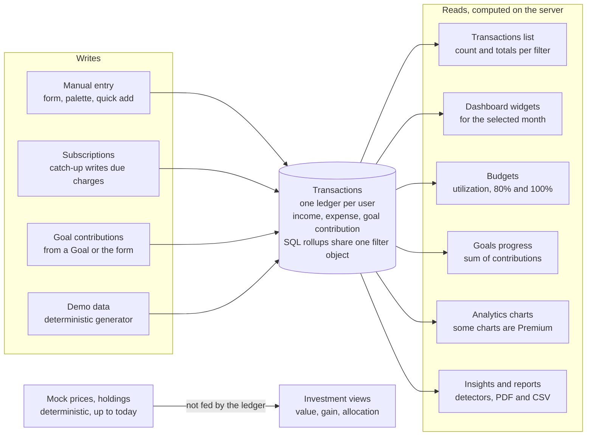

# POC 4 Daybook: Spec Review and Questions

Oct 15, 2026 · @Himanshu

> **Historical record.** This round's questions are all answered, and its answers are recorded in [02-decisions.md](../02-decisions.md), whose Ref column cites the question IDs here. Where this file and the decisions log or the specs differ, they win.

> Round 2 (answers, follow-ups and new questions) is in [round-2-answers-and-follow-ups.md](round-2-answers-and-follow-ups.md). Terminology in this file was updated in round 2: Subscription(s) everywhere.

## Verdict and how to answer

The current spec is strong where most specs are weak (architecture, security, offline mechanics, money handling) and thin where per-feature specs need depth: screens, user flows, lifecycles, edge cases, and what each widget and report actually contains. So I would not "complete" it as one file. I would split it into a brief, a root spec, a decisions log and per-feature specs (see Your process, and my proposal).

This report has the app flow as I understand it, the places where I would do something different and why, the gaps and contradictions I found, a verdict on each Assumed decision, and the full question list.

**How to answer**

- Every question has an ID (for example E2), options, my lean and the reason for it.
- Reply in chat as `E2: B`, `E2: lean`, or in your own words. Or write your answer straight into this file, under the question.
- Priority tags: **Root** blocks the root spec. **Feature** is needed before that feature's spec. **Minor** means my lean is safe; object only if you care.
- Anything you leave unanswered takes my lean and is recorded as Assumed, never Decided, so it stays visible.
- Answering the Root questions first is enough to start the root spec. Feature questions can wait until we write that feature.

## How I understand the app

Everything in Daybook is computed from one ledger of Transactions: Subscriptions write into it, Goals are funded from it, and Budgets, the dashboard, charts, insights and reports all read rollups of it. Investments are the one island, fed by mock prices. Premium only gates views and the Goals cap; it never changes how a number is calculated.

**Data flow:** 4 inputs, 1 ledger, 6 computed views, 1 mock island.



Read left to right: inputs only ever write Transactions, and every view on the right only reads server-side rollups of them, which is why they can agree.

The spec never lists screens or navigation, so the route map below is my proposal, built from the FRs. Anything marked with a question ID is not settled.

| Area            | Route (proposal)                             | What the user does there                                       | Access                           |
| --------------- | -------------------------------------------- | -------------------------------------------------------------- | -------------------------------- |
| Sign up, log in | `/signup`, `/login`                          | Email and password                                             | Logged out                       |
| Onboarding      | `/onboarding`                                | Region, currency, timezone; then Load demo data or Start empty | Logged in, no profile yet        |
| Dashboard       | `/dashboard`                                 | Widgets for the selected month, insights panel                 | Everyone                         |
| Transactions    | `/transactions`                              | Infinite list, filters in the URL, add and edit                | Everyone                         |
| Budgets         | `/budgets`                                   | Limits per category, utilization for a month                   | Everyone                         |
| Subscriptions   | `/subscriptions`                             | List, monthly and annual cost, upcoming renewals               | Everyone                         |
| Goals           | `/goals`, `/goals/[id]`                      | Progress, contributions                                        | Free: 3 active (H3)              |
| Investments     | `/investments`                               | Holdings, allocation, value over time                          | Demo-data users only today (I1)  |
| Analytics       | `/analytics` (J5)                            | All charts; heat map and comparative charts are Premium        | Mixed                            |
| Reports         | `/reports`                                   | Pick a period, download PDF or CSV                             | Quarterly and annual are Premium |
| Learn           | `/learn`, `/learn/[slug]`                    | Articles, news, guides from the CMS                            | Public or logged in (S2)         |
| Settings        | `/settings/...`                              | Profile, appearance, dashboard layout, security, data, billing | Everyone                         |
| Everywhere      | Command palette, sync status, offline banner | Search, quick add, pending count                               | Everyone                         |
| System          | `/offline`, a print route for PDFs           | Service-worker fallback; headless render target                | Internal                         |

**The main journeys**

1. **First run.** Sign up, then onboarding pre-fills region from the browser and currency and timezone from region. The empty dashboard offers two paths: Load demo data, or Add your first Transaction.
2. **Daily loop.** Opening the app runs a boot sequence: session check, Subscription catch-up, price catch-up (I2), offline-queue replay. The dashboard shows the current month. The user adds a Transaction from the header or the palette; the row appears optimistically and the affected numbers refetch.
3. **Planning.** The user sets a limit per expense category. Spending fills the bars, and 80% and 100% produce insights.
4. **Recurring.** The user adds a Subscription. Every due date up to today becomes an expense Transaction; future renewals are only listed.
5. **Saving.** The user creates a Goal and adds contributions from the Goal page or the Transaction form. Net savings splits into "to Goals" and "unallocated".
6. **Exploring.** A chart click (for example a donut slice) opens Transactions filtered through the URL, and the list total equals the slice (J4).
7. **Reporting.** The user picks a month and downloads PDF or CSV. Quarterly and annual show an upgrade prompt on Free.
8. **Upgrading.** A locked feature or the billing page opens Stripe Checkout. On return the app shows "Activating" until the webhook has stored the entitlement (N4). Cancelling in the Customer Portal locks features at period end.
9. **Offline.** A banner and "as of" labels appear. New writes are queued with a Pending sync badge. On reconnect the queue replays in order; rejected items wait in a sync panel (P4).
10. **Leaving.** Logout warns if the queue is not empty, then wipes caches and persisted data (P5).

## Your process, and my proposal

Brief, root spec, per-feature specs is the right shape. I would add three things: a separate decisions log, a golden dataset, and milestones. And I would split the current spec rather than complete it, because about 40% of it is history (considered options, verification) that will bury the requirements once per-feature detail arrives.

**The doc set (B1)**

| File                   | Holds                                                                                                                                                                                                                                                                                                                           | Who reads it                             |
| ---------------------- | ------------------------------------------------------------------------------------------------------------------------------------------------------------------------------------------------------------------------------------------------------------------------------------------------------------------------------- | ---------------------------------------- |
| `00-brief.md`          | What and why, scope, feature list with milestone tags, success criteria                                                                                                                                                                                                                                                         | Anyone, in 5 minutes                     |
| `01-root-spec.md`      | Everything cross-cutting: terms, route map, global flows (boot, auth, offline, premium gating), conventions (money, dates, IDs, the filter object, the period model), architecture and state ownership, API conventions (errors, idempotency, pagination), security model, non-functional targets, testing strategy, milestones | Whoever writes any feature               |
| `02-decisions.md`      | Every D-ID: status, reason, rejected options, what would reopen it                                                                                                                                                                                                                                                              | You, when a choice is questioned         |
| `03-golden-dataset.md` | A tiny fixed dataset and the expected value of every widget, list total and report line                                                                                                                                                                                                                                         | Tests, and every feature spec's examples |
| `features/F01-...md`   | One per feature, fixed template                                                                                                                                                                                                                                                                                                 | Whoever builds that feature              |
| `platform/P1-...md`    | Offline and PWA, data access and security, quality                                                                                                                                                                                                                                                                              | Whoever builds the plumbing              |
| `verification.md`      | Sources and as-of dates                                                                                                                                                                                                                                                                                                         | Re-checks before relying on a fact       |

The golden dataset is the idea I would push hardest. Your top success criterion is that the dashboard, list totals and reports agree. Twenty hand-made Transactions over two months (with a refund, a Subscription charge, a Goal contribution and a mid-month Budget change) and their expected numbers turn that criterion into a test, and give every feature spec the same worked examples.

**Feature split (B2)**

The FRs mix product features with cross-cutting concerns (FR-15 to FR-17, FR-19), so they do not map one-to-one to specs.

| Spec                                             | Covers                    | Depends on     |
| ------------------------------------------------ | ------------------------- | -------------- |
| F01 Auth and account                             | FR-18                     | P2             |
| F02 Onboarding, profile, settings, theme         | FR-18, FR-13 (theme)      | F01            |
| F03 Transactions                                 | FR-2, FR-12 (list filter) | F02            |
| F04 Budgets                                      | FR-3                      | F03            |
| F05 Subscriptions                                | FR-4                      | F03            |
| F06 Goals                                        | FR-5                      | F03, F12 (cap) |
| F07 Investments                                  | FR-6                      | F15            |
| F08 Dashboard and layout                         | FR-1, FR-13 (layout)      | F03 to F07     |
| F09 Analytics and charts                         | FR-7                      | F08            |
| F10 Insights                                     | FR-9                      | F03 to F06     |
| F11 Reports                                      | FR-10                     | F08, F09       |
| F12 Premium and billing                          | FR-11                     | F01            |
| F13 Global search and command palette            | FR-12                     | F03, F05, F06  |
| F14 Learn (CMS)                                  | FR-8                      | none           |
| F15 Demo and seed data                           | FR-20                     | F03 to F07     |
| P1 Offline and PWA                               | FR-14                     | F03            |
| P2 Data access and security                      | FR-19                     | none           |
| P3 Quality: monitoring, CI, performance, testing | FR-15 to FR-17            | all            |

Suggested writing order: root spec, P2, F03, F01 and F02, F04 to F06, F08, F09, F12, P1, F10, F11, F13, F07, F15, F14, P3. Transactions go first because every other number is derived from them.

**Milestones (A4)**

1. M0 Foundation: repo, CI, Neon, database roles, RLS, auth, data access layer.
2. M1 Ledger: Transactions, categories, list, filters, demo-data generator (the list needs volume early).
3. M2 Planning: Budgets, Subscriptions, Goals.
4. M3 Overview: dashboard, widgets, charts, investments.
5. M4 Premium: Stripe, entitlements, gating.
6. M5 Offline: PWA, persisted cache, write queue.
7. M6 Outputs: reports, insights, global search.
8. M7 Content and polish: CMS, performance budgets, hardening.

**Per-feature template (B3)**

```markdown
# F03 Transactions

Milestone · Free/Premium · Depends on · Decisions referenced

1. Summary: one paragraph
2. User stories: As a ..., I want ..., so that ...
3. Scope: in, out, stretch
4. Concepts and fields: field, meaning, required, rules, example (not a schema)
5. Business rules: BR-F03-01 ..., each one testable
6. Calculations: formula plus a worked example from the golden dataset
7. Screens: purpose, sections, actions, plus a state matrix
   (loading, empty, error, offline, pending, locked, read-only)
8. Flows: numbered steps, including the failure branches
9. Validation and messages: field, rule, exact message text
10. Plan gating: the server rule and what the client shows
11. Offline: read, write, queue, conflicts
12. Server surface: endpoints, inputs, outputs, errors, idempotency (conceptual)
13. Cross-feature effects: what it invalidates, what it feeds
14. Edge cases
15. Acceptance criteria: Given/When/Then, each tagged unit, integration or E2E
16. Open questions
17. Illustrations: a rough UI sketch or payload shape, marked illustrative
```

## Where I would push back

Seventeen places where I think a different choice is better than what the spec says now. The first four change user-visible numbers, so they matter most. Each one points to the question where you decide.

1. **The dashboard period (J1).** The spec offers "last 30 days" as a preset, but Budgets and monthly spending only make sense for a calendar month. With 30 days spanning 12 September to 11 October, nobody can say which Budget applies. I suggest the dashboard uses a month picker, and free date ranges live on Transactions and Analytics.
2. **Refunds (E2).** Today a refund is income in the category Refunds. A returned 2,000 jacket then shows 2,000 of extra income, and Shopping stays 2,000 over budget. I suggest a refund is recorded against the original expense category and reduces that category's spending and Budget.
3. **When Subscriptions catch up (G2).** The spec runs catch-up "at session start". Better Auth sessions last [7 days by default](https://www.better-auth.com/docs/concepts/session-management) and extend while used, so an app left open for weeks never catches up. I suggest catch-up on every app boot plus a lazy once-a-day check in the data access layer.
4. **Mock prices go stale (I2).** Prices seeded once end on the seed date, so a month later the growth chart stops a month ago. I suggest prices as a deterministic function of asset and date, filled up to today by the same catch-up pattern as Subscriptions.
5. **Investments only exist for demo-data users (I1).** New users start empty and holdings are read-only, so for every real user FR-6 and the investment widget are permanently empty. That may be fine, but it should be a choice, not a side effect.
6. **"All numbers in SQL" (I3).** Aggregation belongs in SQL, but XIRR needs an iterative solver and chaining time-weighted returns is awkward in SQL. I suggest "computed on the server, aggregation in SQL". I would also drop XIRR unless holdings have deposits and withdrawals, because without cash flows it equals the simple return.
7. **Demo data volume (R1).** A real person logs about 100 to 250 Transactions a month, so three years is roughly 4,000 to 9,000 rows, not tens of thousands. I suggest a realistic demo dataset for users and separate stress accounts (50,000 or more rows) for performance work. This is my estimate, not a sourced figure.
8. **CI database (T3).** Neon branches per run hit free-plan limits and add network time. A Postgres service container in GitHub Actions is free and isolated, and Docker runs on GitHub's machine, not yours. One small job against a Neon branch would still cover Neon-specific role behavior.
9. **CMS webhooks cannot reach localhost (S4).** The spec relies on a CMS webhook to revalidate, but a hosted CMS cannot call your laptop. Sanity's [Live Content API](https://www.sanity.io/docs/nextjs/introduction) revalidates without webhooks; otherwise use a tunnel or time-based revalidation.
10. **Same-day order (E5).** The list orders by date, then id. With random UUIDv4 ids, Transactions on the same day appear in random order. UUIDv7 ids are time-ordered, so same-day rows keep entry order, and inserts stay friendlier to the index.
11. **The runtime role can read auth tables (Q10).** "Auth tables outside RLS" means the role serving all traffic can read every user's email and session rows. A separate database role and pool for Better Auth, with no grants for the runtime role, closes that.
12. **Logout versus the queue (P5).** The spec says logout wipes everything, and also that the write queue is not disposable. Both cannot hold; the root spec needs one rule.
13. **The Goals cap (H3).** If achieved or archived Goals count toward 3, a free user who reaches three Goals can never start a fourth. I suggest counting active Goals only.
14. **The word Subscriptions (C1).** Terms used Subscriptions while the header and brief used a short form, and the word collides with the Stripe subscription behind Premium. **Decided in round 2:** Subscription(s) everywhere, in docs, code and interface; everything on the Stripe side is called Premium (long form: Daybook Premium).
15. **PDF route (M5).** Server-side Chromium works, but the cheapest option was never weighed: a print stylesheet and the browser's Save as PDF, with no runtime dependency. I still lean to Chromium for a real download button; this is so the choice is made on purpose.
16. **CSRF, a cheap second layer.** Besides SameSite and the Origin check, mutating handlers can accept only `application/json`. A cross-site form cannot send JSON without a CORS preflight, which the server never approves.
17. **Number formatting (D2).** Browser locale on many Indian machines is en-US, which shows 100,000 instead of 1,00,000 for INR. I suggest deriving the formatting locale from region, with the browser as fallback.

## Gaps and contradictions

I found 8 contradictions inside the current docs and 22 topics they never cover. Most gaps are product behavior (lifecycles, contents, states), which is exactly what the per-feature specs must pin down.

**Contradictions**

| Where                      | It says                                  | But                                                                                                                   | Fix in                                 |
| -------------------------- | ---------------------------------------- | --------------------------------------------------------------------------------------------------------------------- | -------------------------------------- |
| Terms vs header            | "Subscriptions" is the fixed name        | The header and brief use a short form                                                                                 | C1 (decided: Subscriptions everywhere) |
| Decision log vs Open items | 3 Open decisions                         | Open items lists 14, and most have no D-ID (accessibility, search UI, holdings, Neon region)                          | B1                                     |
| D-58                       | Time-weighted return is Assumed          | Open items lists the same topic as open                                                                               | I3                                     |
| Pending badge              | Assumed in Architecture                  | Decided in FR-2                                                                                                       | B1                                     |
| Logout                     | Every cache and persisted store is wiped | The write queue "is not disposable"                                                                                   | P5                                     |
| FR-1 date range            | Presets include "last 30 days"           | Budgets and monthly spending are per calendar month                                                                   | J1                                     |
| Subscription catch-up      | Runs at "session start"                  | Session start is never defined, and sessions last days                                                                | G2                                     |
| Assumed count              | 29 Assumed decisions                     | Dozens more Assumed statements sit only in FR text (Subscription fields, Goal fields, the 3-character search minimum) | B1                                     |

**Not covered at all**

| Gap                                                                                                             | Where it bites                | Question        |
| --------------------------------------------------------------------------------------------------------------- | ----------------------------- | --------------- |
| Route map and navigation, including mobile                                                                      | Every screen spec             | A5, J5          |
| UI stack: styling, component primitives, forms, validation, dates, toasts, palette                              | Root spec, every form         | U1 to U4, D7    |
| Who builds this, by when, and who approves deviations from the original brief                                   | Scope of every spec           | A1, A2          |
| API conventions: error shape, status codes, pagination envelope, idempotency storage and expiry                 | Every endpoint                | Root spec       |
| `pg` returns bigint and numeric as strings                                                                      | Every sum reaching the client | Root spec       |
| Offline edit conflicts between two devices                                                                      | Offline correctness           | P2              |
| Queue coalescing, sync panel, multi-tab runner, app update flow                                                 | Offline UX                    | P3, P4, P6, P10 |
| What the Transactions header total means when types mix                                                         | Agreement criterion           | E3              |
| Which filter dimensions exist, and which apply to the dashboard                                                 | Agreement criterion           | E11, J3         |
| Contents of each widget                                                                                         | Dashboard spec                | J2              |
| Contents of each report, CSV shape, quarters and fiscal year                                                    | Reports spec                  | M1 to M4, D3    |
| Budget carry-forward, overall utilization, retro edits, removal                                                 | Budgets spec                  | F1 to F4        |
| Subscription end date, pause, backfill on create, deleting one generated charge                                 | Subscriptions spec            | G3 to G9        |
| Goal achieved and archived states, withdrawals, deleting a funded Goal, which Goals stay editable after a lapse | Goals spec                    | H1 to H5        |
| Checkout return before the webhook arrives, or with the Stripe CLI not running                                  | Premium spec                  | N4              |
| How locked Premium features look                                                                                | Every gated screen            | K5              |
| Removing demo data, and demo data in the user's currency                                                        | Demo spec, currency lock      | R2, D1          |
| Change password, active sessions, account deletion, data export                                                 | Account spec                  | Q3 to Q5        |
| Loading, empty, error, stale and locked state conventions                                                       | Every screen                  | Root spec       |
| Input limits: text lengths, amount range, date range                                                            | Every form                    | D5, D6          |
| Browser matrix, given you develop on Linux without Safari                                                       | Testing                       | T6              |
| Security headers and a content security policy                                                                  | Security                      | T7              |

## The Assumed decisions

I agree with 20 of the 31 Assumed rows (the 29, plus the assumed halves of D-26 and D-30) as written, would adjust 10, and would rethink one. Write Confirm, Change or Discuss in Your call; an empty cell means my verdict stands.

| ID   | Decision                                                           | My verdict | Note                                                                                     | Your call |
| ---- | ------------------------------------------------------------------ | ---------- | ---------------------------------------------------------------------------------------- | --------- |
| D-06 | Drizzle on the stable 0.x line                                     | Agree      | Pin the minor version; treat the 1.0 move as its own task later.                         |           |
| D-07 | node-postgres to the pooled endpoint; migrations direct            | Agree      | Also fix how `pg` parses bigint and numeric, which arrive as strings.                    |           |
| D-08 | Next.js 16 latest patch, React Compiler on                         | Agree      | Check patch releases weekly.                                                             |           |
| D-13 | Three roles: owner, runtime, system                                | Adjust     | Add a fourth role for Better Auth's tables (pushback 11).                                |           |
| D-14 | Runtime role created with SQL                                      | Agree      | The RLS suite asserts it.                                                                |           |
| D-15 | Transaction-local user context; empty means no user                | Agree      | Correct for the transaction-mode pooler.                                                 |           |
| D-16 | Authorization in the data access layer; `proxy.ts` optimistic only | Agree      | Matches post-CVE guidance.                                                               |           |
| D-17 | SameSite cookies plus Origin check                                 | Adjust     | Also accept only JSON bodies on mutations (pushback 16).                                 |           |
| D-18 | Entitlements written only by the system role                       | Agree      | The checkout-return reconcile (N4) goes through the same module.                         |           |
| D-19 | Auth tables outside user-scoped RLS                                | Adjust     | Outside RLS, yes; readable by the runtime role, no.                                      |           |
| D-21 | Goal contribution as a third Transaction type                      | Agree      | Withdrawals still open (H1).                                                             |           |
| D-26 | Subscription catch-up mechanism                                    | Adjust     | Trigger on boot plus once a day (G2); a deleted charge becomes a tombstone (G5).         |           |
| D-29 | Lapse keeps data, locks extra Goals                                | Adjust     | Say which Goals stay editable (H4).                                                      |           |
| D-30 | Currency pre-filled, fixed after the first Transaction             | Adjust     | Add a reset-my-data escape (Q6), or one demo-data mistake fixes the currency forever.    |           |
| D-31 | Integer minor units with an exponent table                         | Agree      | Keep amounts as JS numbers under a validated maximum; BigInt does not serialize to JSON. |           |
| D-32 | Calendar dates, calendar months, UUID keys                         | Adjust     | UUIDv7 (E5); "today" comes from the profile timezone (Q8).                               |           |
| D-33 | Budgets per category per month, effective-dated, 80% and 100%      | Adjust     | Define carry-forward and "overall" (F1, F4).                                             |           |
| D-35 | Server-side listing with cursors                                   | Agree      | The right call at this data size.                                                        |           |
| D-36 | Infinite list, virtualization, maxPages, Load more                 | Agree      | maxPages drops pages from the top, so scrolling back up needs previous-page cursors.     |           |
| D-38 | Zustand for UI state; committed filters in the URL                 | Agree      | Name the real stores: sync status, palette, sidebar, layout editing.                     |           |
| D-39 | Route handlers with an idempotency key                             | Agree      | Define where keys are stored and for how long.                                           |           |
| D-48 | Global search with pg\_trgm                                        | Agree      | Numeric queries skip the 3-character minimum.                                            |           |
| D-50 | Comparative charts: budget vs actual, period over period           | Agree      | Fills the brief's undefined term well.                                                   |           |
| D-52 | PDF through server-side Chromium                                   | Agree      | With the print-stylesheet option weighed (M5).                                           |           |
| D-53 | CSV: sanitize text, amounts as numbers                             | Agree      | Amounts unformatted with fixed decimals; dates as ISO.                                   |           |
| D-55 | Theme per device, layout per account                               | Agree      | Matches how people use phones and desktops.                                              |           |
| D-56 | Five rule-based detectors                                          | Adjust     | Add a savings recommendation (L1); the brief asks for one.                               |           |
| D-58 | Time-weighted return as the headline                               | Rethink    | Only differs from simple return when there are cash flows (I3).                          |           |
| D-59 | Sentry cloud; replay as stretch                                    | Agree      | Scrubbing rules belong in P3.                                                            |           |
| D-60 | SonarQube Cloud Free                                               | Agree      | The 50K-line cap applies to private repos (A7).                                          |           |
| D-61 | Vitest, MSW, Playwright, RLS and invariant suites                  | Adjust     | CI database as a service container (T3).                                                 |           |

## Questions

There are 145 questions in 21 groups; 46 are tagged Root, and B4 is already answered. Answering the Root ones is enough to write the root spec. Where I write "No lean", only you can know the answer.

### A. Project framing

- **A1 · Who builds from these specs?** Root. (A) You, by hand. (B) You, with Claude Code doing most of the implementation. (C) A team of trainees. **No lean.** It decides how literal the per-feature specs must be: for agents, every rule needs exact messages, IDs and acceptance criteria.
- **A2 · Timeline, and who approves?** Root. Is there a deadline or time budget? Is there a mentor or assessor who must accept the departures from the original brief (JSON Server removed, a real backend added)? **No lean.** The revised scope is several times the original; if an assessor expects a frontend-only POC, we should know before writing 18 specs.
- **A3 · Product name.** Minor. Is "Daybook", the folder name, the app's name in the interface, manifest and docs? **Lean yes:** a daybook is literally a journal of transactions.
- **A4 · Milestones.** Root. Accept M0 to M7 and tag every feature and stretch item with one? **Lean yes:** it separates must-have from nice-to-have, which the current spec does not.
- **A5 · Device priority.** Root. (A) Desktop first. (B) Mobile first. (C) Both, with phone layouts for entry screens and desktop layouts for analytics. **Lean C:** quick entry happens on phones, analysis on big screens. On phones, a bottom bar with 4 or 5 items plus More.
- **A6 · Interface language.** Minor. English only, no translation layer? **Lean yes:** `Intl` already handles numbers and dates.
- **A7 · Repository visibility.** Minor. Public or private on GitHub? **No lean.** SonarQube Cloud Free caps private projects at 50K lines; a public repo also exposes demo credentials.

### B. Doc structure

- **B1 · Doc set.** Root. Accept brief, root spec, decisions log, golden dataset, feature specs, platform specs and verification log? Every decision, including those now only in FR text, gets a D-ID, and Open items move into the log. **Lean yes.**
- **B2 · Feature split.** Root. Accept F01 to F15 and P1 to P3? **Lean yes.** One spec per FR was the alternative; FR-15 to FR-17 and FR-19 are not features.
- **B3 · Template.** Root. Accept the 17-section template? Small features write "none" in a section instead of dropping it, so gaps stay visible. **Lean yes.**
- **B4 · Source of truth.** Root. **Answered: A, markdown in the repo.** You said this report belonged here, so every spec file is written directly into the repo.
- **B5 · Golden dataset.** Root. Accept it as its own file and the oracle for invariant tests? **Lean yes.**
- **B6 · Status tags.** Minor. Keep Decided, Assumed and Open; add Stretch and Out? **Lean yes:** stretch and out-of-scope items are spread across three sections today.

### C. Terminology

- **C1 · Name for tracked recurring payments.** Root. **Answered: Subscription(s) everywhere, in docs, code and interface.** The Stripe side is always Premium (long form: Daybook Premium).
- **C2 · Do Subscriptions cover any recurring bill?** Feature. (A) Subscriptions only (streaming, software). (B) Any fixed recurring expense: rent, insurance, loan EMIs, gym. **Lean B:** the mechanism is identical; the interface label becomes "Subscriptions and bills".
- **C3 · Recurring income.** Feature. Should salary auto-generate like Subscriptions? **Lean no:** income varies, and the demo generator already produces salary.

### D. Money, currency, locale, dates

- **D1 · Supported currencies.** Root. (A) All of ISO 4217. (B) A curated list. **Lean B: INR, USD, EUR, GBP, JPY, KWD.** Each needs a tested exponent and its own demo-data magnitudes; JPY and KWD cover exponents 0 and 3.
- **D2 · Formatting locale.** Feature. (A) Browser locale. (B) Derived from region, so IN formats 1,00,000. (C) A stored locale field. **Lean B,** with the browser as fallback.
- **D3 · Year and quarter boundaries.** Root. (A) Calendar years and quarters. (B) A fiscal-year start in the profile (India runs April to March). **Lean A for v1,** with every period computed by one function so B is a small change later. If your reports should follow the Indian fiscal year, say so now.
- **D4 · Week start.** Minor. Monday or Sunday, for the heat map and weekly views? **Lean derived from region.**
- **D5 · Date limits.** Feature. Future-dated Transactions allowed? Earliest date? **Lean no future dates and at most 10 years back.** A future expense would count against a future month's Budget; Subscriptions already cover the future.
- **D6 · Amount limits.** Feature. **Lean greater than zero, at most 999,999,999.99 in major units,** with the sign always coming from the type, never from the amount.
- **D7 · Date library.** Root. (A) date-fns 4 with its timezone add-on. (B) A Temporal polyfill. (C) Hand-written helpers on ISO strings. **Lean A:** stable and tree-shakeable; Temporal is cleaner but Safari support is still unsettled. Calendar dates travel as `YYYY-MM-DD` strings either way.

### E. Transactions

- **E1 · Text fields.** Feature. (A) One description. (B) A description plus an optional note. (C) Payee, description and note. **Lean B: description required (up to 120 characters), note optional (up to 500).** A separate payee helps search and "top merchants" but adds a field to every form.
- **E2 · Refunds.** Feature. (A) Income in category Refunds, as now. (B) A refund entry in the original expense category that reduces its spending and Budget. **Lean B** (pushback 2). Income then loses its Refunds category.
- **E3 · The list header total.** Root. The list mixes income, expenses and contributions. (A) One net number. (B) Three numbers: In, Out, To Goals. (C) A total only when one type is filtered. **Lean B:** a single signed total over mixed types is easy to misread and hard to match against the dashboard.
- **E4 · Sort options.** Feature. Date only, or amount too? **Lean date (newest first by default) and amount.** Each sort needs its own cursor shape, so more than two gets costly.
- **E5 · ID format.** Root. UUIDv4 or UUIDv7? **Lean v7** (pushback 10).
- **E6 · Delete.** Feature. (A) Confirm dialog, then delete. (B) Delete at once with a 5-second Undo; the request goes out only after the window. (C) Soft delete with a trash. **Lean B:** fastest for the user, and the delayed send keeps the offline queue simple.
- **E7 · Bulk actions.** Minor. Multi-select delete or recategorize? **Lean stretch.**
- **E8 · Import.** Minor. Import a bank CSV? **Lean out:** the demo generator covers volume, and import is a feature of its own (column mapping, duplicates).
- **E9 · Duplicate.** Minor. A Duplicate action on a row? **Lean yes:** cheap, and common for repeat purchases.
- **E10 · Attachments.** Minor. Receipt photos? **Lean out:** needs file storage.
- **E11 · Filter dimensions.** Root. Proposed: date range, type, categories (several), text, amount minimum and maximum, source (manual or from a Subscription), Goal. **Lean as listed.** This becomes the one filter object shared by the list, Analytics and reports.
- **E12 · Where entry happens.** Feature. (A) A dialog or bottom sheet over the current page, opened from the header, the palette or a floating button on phones. (B) A full page. **Lean A:** entry is the most frequent action and should not lose your place.
- **E13 · Defaults.** Minor. A new Transaction defaults to expense, today in the profile timezone, and the last-used category? **Lean yes.**

### F. Budgets

- **F1 · Carry-forward.** Root. Does a limit set for October repeat every month until changed? (A) Yes, effective from a month onward. (B) Each month is set separately, with "copy last month". **Lean A:** what the spec's effective dating implies, stated outright.
- **F2 · One-month override.** Feature. A higher limit for December only, back to normal in January? **Lean stretch:** it needs an end month on the override.
- **F3 · Retroactive changes.** Feature. Can the effective month be in the past? **Lean yes, with a warning that past utilization will change.** The default stays the current month.
- **F4 · Overall utilization.** Root. (A) Spending in budgeted categories against the sum of their limits, with unbudgeted spending shown beside it. (B) All spending against the sum of limits. (C) A separate total monthly budget. **Lean A:** with B, categories nobody budgeted push "overall" past 100%.
- **F5 · Removing a Budget.** Feature. It ends from a chosen month and history is kept? **Lean yes.**
- **F6 · Thresholds.** Minor. Fixed at 80% and 100%, or set per Budget? **Lean fixed.**
- **F7 · Where alerts show.** Feature. Insights only, or also colored states on Budget cards, or a toast when a Transaction crosses a threshold? **Lean insights plus card states.** No toast, since pending changes must not alert and a toast for confirmed ones arrives late.
- **F8 · Subscriptions and refunds in Budgets.** Feature. Subscription-generated expenses count toward Budgets, and refunds reduce them? **Lean yes to both.**

### G. Subscriptions

- **G1 · Cadences.** Feature. Weekly, monthly, quarterly, yearly; or also every N days or months? **Lean the four fixed ones.**
- **G2 · Catch-up trigger.** Root. **Lean: on every app boot, a lazy once-a-day check in the data access layer, and on Subscription create and edit** (pushback 3).
- **G3 · Backfill on create.** Feature. A Subscription created with a start date 6 months ago: (A) generate all 6 past charges, (B) ask with a toggle, default off, (C) start from today. **Lean B:** people often add Subscriptions they have paid for years and do not want 40 rows.
- **G4 · Price changes.** Feature. Editing a Subscription's amount applies to future charges only? **Lean yes;** past charges are edited one by one.
- **G5 · Deleting one generated charge.** Feature. It counts as skipped, and catch-up never recreates it (a tombstone on Subscription and due date)? **Lean yes.**
- **G6 · Lifecycle.** Feature. Active and cancelled (with an end date). Is pause needed? **Lean no pause:** cancel and re-add covers it.
- **G7 · Free trials.** Minor. **Lean out.**
- **G8 · Renewal horizon.** Feature. The Subscriptions page lists the next 30 days; the insight covers 7. **Lean as stated.**
- **G9 · Deleting a Subscription.** Feature. (A) The Subscription goes; its past charges stay as normal expenses, unlinked. (B) Only cancel is allowed once charges exist. **Lean A,** with a confirm that says how many past charges stay.
- **G10 · Editing one charge.** Feature. Category and amount of a single generated charge editable without touching the Subscription? **Lean yes.**

### H. Goals

- **H1 · Withdrawals.** Feature. Can money leave a Goal, for example when you spend the vacation fund? (A) No. (B) Yes, as a negative contribution that returns money to "unallocated". **Lean B:** without it, a spent fund still shows 100%.
- **H2 · States.** Feature. Active, achieved (automatic at 100%), archived (manual). Over-funding allowed and shown above 100%? **Lean yes.**
- **H3 · What the free cap counts.** Root. **Lean active Goals only** (pushback 13).
- **H4 · After a lapse.** Feature. Which 3 Goals stay editable? (A) The 3 oldest. (B) The user picks. (C) The 3 most recently funded. **Lean A:** deterministic and needs no extra screen. B is friendlier but adds a flow.
- **H5 · Deleting a funded Goal.** Feature. (A) Blocked; archive instead. (B) Deletes its contributions too, after a confirm. (C) Contributions stay, unlinked. **Lean A, plus B as an explicit "Delete with contributions" for mistakes.** C leaves contributions pointing at nothing.
- **H6 · Required monthly amount.** Minor. With a target date, show "save X a month to reach it"? **Lean yes:** one division. Projected completion stays out.
- **H7 · The over-saving warning.** Feature. A contribution triggers a warning when it exceeds what? (A) This month's unallocated savings. (B) All-time unallocated savings. **Lean B:** people often fund Goals from earlier months' savings.
- **H8 · Appearance.** Minor. An icon and color per Goal from a fixed list? **Lean yes.**

### I. Investments

- **I1 · Who has a portfolio.** Root. (A) Demo-data users only, as now. (B) Every user gets a seeded portfolio at signup. (C) Users add holdings from a mock asset catalog. **Lean A for v1, C as stretch:** B puts fake data into a real account, and C is a second CRUD feature with little new learning. Tell me if an empty investment widget for real users bothers you.
- **I2 · Prices up to today.** Root. (A) A fixed history ending on the seed date. (B) Deterministic prices per asset and date, stored and caught up to today on boot. **Lean B** (pushback 4).
- **I3 · Metrics.** Feature. Proposed: total value, change over the selected period, unrealized gain or loss, allocation by type, gain per holding. Time-weighted return only if holdings have dated buys and sells; no XIRR. **Lean as proposed.**
- **I4 · Catalog size.** Minor. About 6 assets per type (24 in total), crypto more volatile? **Lean yes.**
- **I5 · Currency.** Minor. Mock assets priced directly in the user's currency? **Lean yes:** unrealistic, but it is mock and avoids exchange rates.

### J. Dashboard

- **J1 · Period control.** Root. (A) A month picker with previous and next. (B) Date ranges with presets, as now. **Lean A** (pushback 1).
- **J2 · Widget list.** Root. Proposed v1: Spending this month (against last month), Net savings with the Goals split, Budget utilization (top 5), Subscription cost (monthly, annual, next renewal), Investment growth, Spending by category, Income vs expenses (12 months), Insights, Goals progress, Recent Transactions. Later: Upcoming renewals, Latest from Learn. **Lean as listed;** add or cut.
- **J3 · Dashboard filters.** Root. Period only, or period plus categories? **Lean period only:** a category filter makes net savings and Budgets ambiguous. Transactions and Analytics carry the full filter.
- **J4 · Drill-down.** Feature. Clicking a chart element opens Transactions with the matching URL filter? **Lean yes:** it makes the agreement criterion something users can see.
- **J5 · Analytics page.** Root. A separate page for full charts, or everything on the dashboard? **Lean separate:** the dashboard stays fast and Premium charts get a home.
- **J6 · First paint.** Feature. Prefetch dashboard data on the server and hydrate, or skeletons and client fetch? **Lean server prefetch:** better LCP, and TanStack keeps the persisted copy when it is newer.
- **J7 · Empty state.** Feature. Each widget with its own call to action, or one onboarding panel until the first Transaction? **Lean one panel.**

### K. Charts

- **K1 · Inventory.** Root. Proposed: spending over time, spending by category (donut), income vs expenses (grouped bars), budget vs actual (Premium), period over period (Premium), calendar heat map (Premium), portfolio value (line), allocation (donut), Goal progress. **Lean as listed.**
- **K2 · Many categories.** Feature. 14 expense categories make an unreadable donut. Top 6 plus Other? **Lean yes,** with one fixed color per category across every chart.
- **K3 · Export.** Feature. PNG through the ECharts toolbox, plus a View as table toggle that doubles as the accessible version? **Lean yes;** data export stays in CSV reports.
- **K4 · Heat map range.** Minor. One calendar year with a year selector? **Lean yes.**
- **K5 · Locked charts on Free.** Root. (A) Hidden. (B) A locked card with a static sample picture and Upgrade. (C) A blurred version of the user's own data. **Lean B:** C sends Premium data to a Free client, which defeats server enforcement.

### L. Insights

- **L1 · Savings recommendation.** Feature. Add a detector that phrases a trend as advice, for example "Entertainment is 40% above your 3-month average; matching the average saves X"? **Lean yes:** the brief names savings recommendations, and none of the five detectors is one.
- **L2 · Period.** Feature. Insights follow the dashboard month, or always the current month? **Lean follow the dashboard month.**
- **L3 · Dismissing.** Feature. (A) Insights cannot be dismissed. (B) Dismissed per user, keyed by detector, subject and period. **Lean B:** alerts you cannot dismiss get ignored, and it is a small, real state problem.
- **L4 · Volume.** Minor. Top 5 by severity on the dashboard, all of them on an Insights page? **Lean yes.**

### M. Reports

- **M1 · Contents.** Root. Proposed sections: summary (income, expenses, net savings, savings rate), spending by category, budget vs actual, Goals progress, Subscription cost, the 10 largest expenses, and for quarterly and annual a month-by-month table. **Lean as listed, investments left out:** mock holdings in a financial report read oddly.
- **M2 · CSV shape.** Root. (A) One row per Transaction in the period. (B) The summary tables. (C) Both, as two downloads. **Lean C:** A is what spreadsheets need, B is what matches the PDF.
- **M3 · Report filters.** Feature. Period only, or period plus categories? **Lean period only for v1;** "builder" then means choosing report type and period.
- **M4 · Partial periods.** Feature. Can the current month be reported, marked "partial, to date"? **Lean yes.**
- **M5 · PDF route.** Feature. Server-side Chromium (current) or a print stylesheet with the browser's Save as PDF? **Lean Chromium** (pushback 15).
- **M6 · Charts in the PDF.** Feature. **Lean yes, drawn with ECharts' SVG renderer on the print route** so they stay sharp when printed.

### N. Premium and billing

- **N1 · Prices.** Feature. Monthly only, or monthly and yearly? **Lean both:** the Customer Portal handles switching, which exercises proration for free.
- **N2 · Trial.** Minor. **Lean no trial.**
- **N3 · Price and currency.** Minor. What amount, in which currency? **No lean;** for example 4.99 USD or 399 INR.
- **N4 · Return from Checkout.** Root. (A) Show "Activating" and poll until the webhook lands. (B) Also reconcile on return: the server reads the Checkout session and entitlements from Stripe through the system module. **Lean B:** it works even when the Stripe CLI is not running, and removes the race.
- **N5 · Cancel.** Feature. Cancellation takes effect at period end, Premium kept until then? **Lean yes.**
- **N6 · Failed renewal.** Feature. Keep Premium while Stripe retries, or lock at once? **Lean follow Stripe's active entitlements, with no custom grace logic.** To confirm in Stripe's docs when writing F12.
- **N7 · Upgrade entry points.** Minor. The billing page plus every locked spot (a chart, the fourth Goal, a quarterly report)? **Lean yes.**

### O. Search

- **O1 · Interface.** Root. (A) Command palette on Ctrl or Cmd plus K. (B) A search box in the header. **Lean A, plus a visible search button that opens it,** because phones have no keyboard shortcut.
- **O2 · Quick actions.** Feature. The palette also offers Add Transaction, Add Subscription, Add Goal, go to any page, switch theme? **Lean yes.**
- **O3 · Searched fields.** Feature. Transaction description and note, Subscription name, Goal name, and exact amounts? **Lean yes.**
- **O4 · Results.** Minor. 5 per group, plus "See all in Transactions", which opens the list with the text filter set? **Lean yes.**
- **O5 · Articles.** Feature. Include Learn content in search? **Lean yes if the CMS is Sanity,** which can query text; otherwise later.

### P. Offline and PWA

- **P1 · Write scope.** Root. Transactions only, or Transactions, Budgets, Subscriptions and Goals? **Lean all four,** as the spec leans: one mechanism, and blocking some writes offline feels broken.
- **P2 · Conflicts.** Root. An edit made offline to a row that changed meanwhile on another device. (A) Last write wins. (B) A version check: the server answers 409 and the item is shown as rejected, with both versions. **Lean B:** the app's promise is trustworthy numbers, and you built If-Match handling in Outpost already.
- **P3 · Coalescing.** Feature. Create then edit offline becomes one create; create then delete removes both? **Lean yes.**
- **P4 · Sync panel.** Feature. A panel of pending and rejected items with Retry, Edit and Discard, opened from the sync status in the header? **Lean yes.**
- **P5 · Logout with pending items.** Root. (A) Warn, offer Sync now when online, otherwise Discard and log out. (B) Keep the queue under the user id and resume on that user's next login. **Lean A:** B leaves one user's unsynced data on a shared device.
- **P6 · Update flow.** Feature. When a new version is ready, show "Update available" with Reload, and migrate queued items to the new schema version before replay? **Lean yes.**
- **P7 · Offline pages.** Feature. Open from cache: dashboard, Transactions, Budgets, Subscriptions, Goals, Investments, already-read Learn articles. Show an offline message: reports, billing, search, settings. **Lean as listed.**
- **P8 · App badge.** Minor. The Badging API shows the pending count on the installed icon? **Lean stretch:** cheap, and you know it from Outpost.
- **P9 · Push.** Minor. Push reminders for renewals? **Lean out:** nothing runs on a server while your laptop sleeps.
- **P10 · Multi-tab.** Feature. One queue runner across tabs through the Web Locks API? **Lean yes:** idempotency makes double replays safe; the lock makes them rare.
- **P11 · Tooling.** Root. Serwist or a hand-written service worker? **Lean Serwist:** you hand-wrote one in Outpost, and Serwist reads the Next.js build output for precaching.

### Q. Auth, profile, settings

- **Q1 · Signup fields.** Feature. Email, password and display name? **Lean yes.**
- **Q2 · Password rules.** Minor. At least 8 and at most 128 characters, no composition rules? **Lean yes:** length matters more than character classes.
- **Q3 · Change password.** Feature. From Settings while logged in? **Lean yes:** it is the only self-service recovery besides your script.
- **Q4 · Active sessions.** Feature. A list of devices with "Sign out other devices"? **Lean yes:** revocable sessions were a reason to pick Better Auth, and it ships [listSessions and revokeOtherSessions](https://www.better-auth.com/docs/concepts/session-management).
- **Q5 · Account deletion and data export.** Feature. **Lean both in:** deletion is a cascade the RLS design already supports, and export reuses the CSV pipeline.
- **Q6 · Reset my data.** Feature. Deletes all finance data, keeps the account, and unlocks the currency? **Lean yes,** behind a typed confirmation.
- **Q7 · Session length.** Minor. Better Auth's default of 7 days, extended while used? **Lean yes.**
- **Q8 · Whose "today".** Feature. The profile timezone or the device's? **Lean profile,** with a notice when the device differs (for example while travelling).
- **Q9 · Editing the profile later.** Minor. Region and timezone editable; currency locked once Transactions exist? **Lean yes.**
- **Q10 · A role for auth tables.** Root. A separate database role and pool for Better Auth (pushback 11)? **Lean yes.**
- **Q11 · Rate limiting.** Minor. Better Auth's [built-in limiter](https://www.better-auth.com/docs/concepts/rate-limit) is on in production builds, allows 100 requests per 10 seconds, limits email sign-in to 3 per 10 seconds, and stores counts in memory by default. Keep those defaults and add nothing on the finance API? **Lean yes.** This closes the spec's open item.

### R. Demo and seed data

- **R1 · Volume.** Root. A realistic demo dataset (3 years, about 4,000 to 9,000 rows) and separate stress accounts (50,000 rows or more)? **Lean yes** (pushback 7).
- **R2 · Mixing with real data.** Feature. (A) Load demo data only into an empty account. (B) Allow it anytime, rows flagged as demo, with Remove demo data. **Lean A, and flag the rows anyway,** so Remove demo data is exact.
- **R3 · What demo data includes.** Feature. Transactions, Budgets, Subscriptions, Goals with contributions, and the portfolio? **Lean all of it.**
- **R4 · Seeded accounts.** Feature. One Free realistic, one Premium realistic, one Premium stress account, with Premium granted by the seed through the system role, without Stripe? **Lean yes.**

### S. Learn (CMS)

- **S1 · Which CMS.** Root. Sanity, Payload, Strapi, or another hosted one? **Lean Sanity:** hosted, safe rich text (Portable Text, never raw HTML), draft preview, and live revalidation without webhooks. Payload would put CMS tables beside your RLS tables.
- **S2 · Public or logged in.** Feature. Can logged-out visitors read Learn? **Lean public:** it exercises static generation and shared caching on the only content where the spec allows them.
- **S3 · Content model.** Feature. (A) Three types: Article, News, Guide. (B) One Post type with a kind field and topics. **Lean B:** one listing, one detail page, one query.
- **S4 · Revalidation on localhost.** Root. Sanity Live, a tunnel, or time-based? **Lean Sanity Live** (pushback 9). Whether it needs your localhost origin allowed in Sanity's CORS settings is unchecked.
- **S5 · Who writes the content.** Minor. **Lean a seed script that loads about 12 posts.**
- **S6 · On the dashboard.** Minor. A Latest from Learn widget? **Lean later.**

### T. Quality, performance, CI

- **T1 · Performance budgets.** Root. Proposed: on the dashboard, LCP at most 2.5 s and CLS at most 0.1 (mobile emulation, warm database); INP at most 200 ms for filtering and adding; first-load JavaScript for the dashboard route at most 200 KB compressed, with charts lazy; server time p95 under 300 ms when warm. **Lean these.** The first three are Google's "good" Core Web Vitals thresholds; the last two are my guesses, to check against a first measurement.
- **T2 · How it is measured.** Feature. Lighthouse for LCP and CLS, a scripted Playwright interaction for INP (a page-load audit cannot measure it), web vitals sent to Sentry? **Lean yes.**
- **T3 · CI database.** Root. A Postgres service container plus one Neon smoke job? **Lean yes** (pushback 8).
- **T4 · Coverage.** Minor. A target only for domain modules (money, dates, filters, `can()`, detectors), say 80%, and none globally? **Lean yes.**
- **T5 · Accessibility.** Root. WCAG 2.2 AA for core flows, with automated axe checks in Playwright? **Lean yes.**
- **T6 · Browsers.** Root. Latest Chrome, Edge and Firefox, plus WebKit through Playwright standing in for Safari, since you develop on Linux? **Lean yes,** with real iOS behavior marked unverified.
- **T7 · Security headers.** Feature. A content security policy and the usual headers? **Lean yes:** Stripe Checkout and the Portal are redirects, so the policy stays simple.
- **T8 · Feature flags.** Minor. **Lean out.**

### U. UI stack

- **U1 · Styling and components.** Root. (A) Tailwind CSS with shadcn/ui on Radix primitives. (B) Tailwind with React Aria Components. (C) CSS Modules and your own components. **Lean A:** the most common pairing, accessible primitives, and a ready command palette (cmdk). B has stronger accessibility; C is the most work.
- **U2 · Forms and validation.** Root. Zod schemas shared by client and server, with React Hook Form or TanStack Form? **Lean Zod with React Hook Form;** Zod is already in your Outpost stack.
- **U3 · Small libraries.** Minor. Icons from lucide, toasts from sonner, theme handling from next-themes? **Lean yes.**
- **U4 · Visual direction.** Minor. A look you already have in mind, or a design pass later? **Lean later.**

## Next steps

Once the remaining 45 Root questions are answered, the root spec can be written; nothing else is blocked on you.

1. You answer the Root questions in chat or by writing into this file, and fill Your call on the Assumed table.
2. I turn every answer into a D-ID with its status, so the decisions log starts clean.
3. We update the brief: scope, milestones, feature list.
4. I draft the root spec, then the golden dataset.
5. Per-feature specs follow in the suggested order; each one starts by settling its Feature questions.
6. A final pass checks that every FR maps to a spec and every business rule to a test.

**Sources** (checked 15 October 2026)

- [Better Auth: Rate limit](https://www.better-auth.com/docs/concepts/rate-limit)
- [Better Auth: Session management](https://www.better-auth.com/docs/concepts/session-management)
- [Sanity: Sanity and Next.js](https://www.sanity.io/docs/nextjs/introduction)
